<p align="center">
  
</p>

<p align="center">
  <a href="https://github.com/agent-engineering-studio/dpc-radar/actions/workflows/ci.yml"></a>
  <a href="https://pypi.org/project/dpc-radar/"></a>
  <a href="https://agentengineering.it/dpc-radar/"></a>
  
  
  
  <a href="https://github.com/agent-engineering-studio/dpc-radar/blob/main/LICENSE"></a>
</p>

**dpc-radar** is a small, typed Python library for the open radar data of
the Italian **Civil Protection Department** (*Dipartimento della Protezione
Civile*, DPC). A national network of weather radars, together with
thousands of rain gauges, measures rain over all of Italy, and the DPC
publishes a new map **every 5 minutes**, free for anyone. This library lets
you use those maps from a script: which frame is the latest, how to download
it, and how to read the API's answers, including its surprises.

```python
async with RadarClient() as radar:
    rain = await radar.latest("CUM24")  # the last 24 hours of rain, all of Italy
print(rain.sample([(15.78, 37.92)]))  # mm at Melito di Porto Salvo (192 on 10 October 2026)
```

> **Work in progress.** dpc-radar is being extracted from
> [Limen](https://github.com/agent-engineering-studio/limen). Today it holds
> the products, the rain grid, the client, the archive of the «Merging», the
> 2010–2025 history and the criticality bulletins. Next: the ideas on the
> [roadmap](https://agentengineering.it/dpc-radar/roadmap/).

**Try it now, nothing to install:** open the
[first notebook in Colab](https://colab.research.google.com/github/agent-engineering-studio/dpc-radar/blob/main/notebooks/01_first_rain_map.ipynb)
and draw today's rain map of Italy in five minutes. Four more notebooks and
four small apps are [below](#notebooks-and-example-apps).

---

## Contents

- [The radar of Italy, in 30 seconds](#the-radar-of-italy-in-30-seconds)
- [Why it matters](#why-it-matters)
- [What a storm looks like](#what-a-storm-looks-like)
- [How a radar measures rain, in plain words](#how-a-radar-measures-rain-in-plain-words)
- [The products](#the-products)
- [The open data behind it](#the-open-data-behind-it)
- [Who is it for, and what you can build](#who-is-it-for-and-what-you-can-build)
- [Notebooks and example apps](#notebooks-and-example-apps)
- [Quick start](#quick-start)
- [Keep the «Merging», read fifteen years of history](#keep-the-merging-read-fifteen-years-of-history)
- [Where the radar can be trusted](#where-the-radar-can-be-trusted)
- [How far the radar alone is from the «Merging»](#how-far-the-radar-alone-is-from-the-merging)
- [How rare is this rain, here](#how-rare-is-this-rain-here)
- [The official alert, as data](#the-official-alert-as-data)
- [How it works](#how-it-works)
- [The traps we already fell into](#the-traps-we-already-fell-into)
- [API at a glance](#api-at-a-glance)
- [Roadmap, and where AI helps](#roadmap-and-where-ai-helps)
- [Contributing](#contributing)
- [Data licence and credits](#data-licence-and-credits)

---

## The radar of Italy, in 30 seconds

A weather radar sends out a pulse of microwaves and listens for the echo.
Raindrops reflect it: the stronger the echo, the heavier the rain. The DPC
joins the radars that cover Italy into **one national map**, and then
corrects the radar with what the **rain gauges** on the ground really
collected. The correction is called the **«Merging»**.

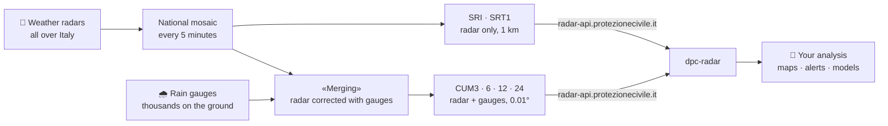

What you can do with it, for example:

- know **how much it has rained** in a place in the last 3, 6, 12 or 24 hours;
- see a **storm arriving**, 5 minutes at a time;
- feed **flood and landslide models** with rain that was measured, not forecast;
- keep your own **archive**: the DPC keeps only about five months.

## Why it matters

Italy is a country of short, steep valleys. A storm can pour a month of rain
on one of them in a few hours, and leave the next one dry. A **forecast**
says what will probably happen over a wide area. A **measurement** says what
is happening, here, now. On 10 October 2026 the forecast for Melito di Porto
Salvo was 20 mm; the measurement was 192.

The measurement exists, it is public, and it is free. What is missing is the
last step: getting it into a program without a week of work. That is what
this library does, and these are the benefits.

| | Without dpc-radar | With dpc-radar |
|---|---|---|
| **Getting a frame** | read the web viewer's traffic to find two undocumented calls, a required header and a signed link | `await radar.latest("CUM24")` |
| **Rain at a place** | open a GeoTIFF, handle two map projections and the «no data» value | `rain.sample([(lon, lat)])` |
| **A place nobody measured** | usually read as zero: «dry» | `None`: «not measured» |
| **A faulty frame** | a false alarm of 7,000 mm | `frame.check(previous)` says `rejected` |
| **A faulty rain gauge** | 126 mm every three hours under a dry sky | `frame.quality(radar=...)` masks it and says `gauge_only` |
| **Radar-only rain** | 20 % more than the «Merging», and 70 % more often above 30 mm | `correct(frame)`: the frame times a factor measured place by place |
| **Data older than five months** | gone | your own archive, one line a night |
| **Rain per hour, corrected with gauges** | not published | `MergingArchive.hourly(...)` |
| **The official alert** | a web page and a PDF | `bulletin.zone_at(lon, lat).colour` |

Three things we care about, beyond the code:

- **Honest numbers.** The library never invents a value. Where the radar
  did not look, it says so.
- **Measured claims.** Every cleaning rule runs on a
  [benchmark of known cases](https://agentengineering.it/dpc-radar/benchmark/)
  before it ships; the failures are published with the successes.
- **Public money, public data, public code.** The radars are paid by
  everyone. The more people can read their data, the more it is worth.

## What a storm looks like

On **10 October 2026** a storm hit the area around Reggio Calabria, in the
toe of Italy. This is the rain of those 24 hours, from one frame of the
«Merging» CUM24 product:

<p align="center">
  
</p>

The radar sees the storm **while it happens**. Here is the rain intensity
(SRI, in mm per hour) at four moments of the same day:

<p align="center">
  
</p>

> Look at the arcs west of Sardinia at 06:00. Rings centred on a single
> radar usually mean an artefact, not a storm: the radar picks up echoes from
> the sea or from bent beams. Check a frame against the one before it before
> you trust it ([the traps](#the-traps-we-already-fell-into)).

And this is the same storm in **one place**, hour by hour. At Melito di
Porto Salvo most of the rain fell before dawn, between midnight and 05:00
UTC, with up to **21 mm in a single hour**:

<p align="center">
  
</p>

Radar alone, or radar corrected with the gauges? At Melito the gauges
(«Merging») measured **192 mm** in the day, and the radar alone saw only
**115 mm**, 60 % of it. Over the whole box, though, the radar read about **12 % more**
than the gauges. The radar is wrong in both directions, depending on the
place. That is why the «Merging» exists: it keeps the radar's picture and
corrects it to what the gauges collected.

<p align="center">
  
</p>

Zoom out, and five months of frames tell the story of a season. Averaged
over all of Italy's land, 10 October was not even the wettest day of the
autumn: 21 October was (19.4 mm on average against 7.1). A storm that
devastates one valley can be a small bar on a national chart.

<p align="center">
  
</p>

Every image above is made from real DPC frames by
[`docs/make_images.py`](https://github.com/agent-engineering-studio/dpc-radar/blob/main/docs/make_images.py),
with the functions of this library. The
[second notebook](https://github.com/agent-engineering-studio/dpc-radar/blob/main/notebooks/02_anatomy_of_a_storm.ipynb)
rebuilds this storm step by step.

## How a radar measures rain, in plain words

You do not need this section to use the library. You need it to know **how
far to trust the numbers**.

### 1. A radar listens to echoes

A weather radar is a dish that turns. It sends a short pulse of microwaves,
a few centimetres long, and listens. If the pulse meets raindrops, a tiny
part of it bounces back.

- **How long** the echo takes to come back says how far the rain is.
- **How strong** it is says how much water is up there. This strength is
  called *reflectivity*.

The dish turns all the way round, tilts up a little, and turns again. In a
few minutes it has scanned the sky for 200 km around. That is why a new map
comes out every five minutes.

### 2. From echo to millimetres: an estimate, not a measurement

Here is the weak point. The echo does not depend only on *how much* water
there is, but very strongly on *how big* the drops are: one 4 mm drop sends
back as much echo as about four thousand 1 mm drops. The radar cannot count
drops. It uses a formula built on the average rain, and the classic one
(Marshall and Palmer, 1948) gives these rates:

| Echo strength | Rain rate | It feels like |
|---|---|---|
| 20 dBZ | about 0.6 mm/h | drizzle |
| 30 dBZ | about 3 mm/h | steady rain |
| 40 dBZ | about 12 mm/h | heavy rain |
| 50 dBZ | about 50 mm/h | a cloudburst |

If today's drops are larger or smaller than average, the rain is wrong, even
with a perfect radar. Hail is the extreme case: a few stones echo like a
flood.

### 3. The radar looks high above your head

<p align="center">
  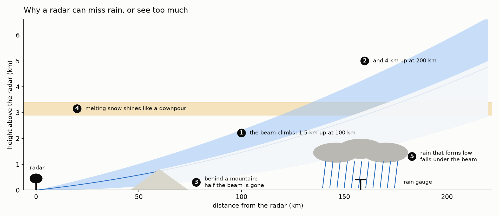
</p>

The beam leaves almost flat, but the Earth curves away under it. ① At
100 km the beam is 1.5 km above the radar; ② at 200 km it is 4 km up. What
the radar sees there is not what reaches the ground:

- ③ **Mountains block the beam.** Behind a ridge the radar sees less, or
  nothing. Italy is mostly mountains.
- ④ **Melting snow looks like a downpour.** High up, rain is often snow. As
  it melts it gets a coat of water and echoes much more than the rain it
  becomes. On the map it is a ring of false heavy rain.
- ⑤ **Rain can form under the beam.** Against a slope, moist air rises and
  the drops grow in the last kilometre before the ground. The radar, looking
  higher, misses that water. This is the likely story of Melito, where it saw
  115 mm of 192.
- **Heavy rain hides what is behind it.** The pulse loses strength crossing
  a storm, so a second storm further away looks weaker than it is.
- **Not every echo is rain.** Hills, the sea, wind farms, and on some days
  the air itself, which bends the beam down to the ground. These are the
  arcs and disks that appear on the map where no cloud is.

### 4. The rain gauge: true, but only where it stands

A rain gauge is a funnel on a pole that collects the rain and weighs or
counts it. It measures the water that really reached the ground. But it
samples a patch as wide as a dinner plate, and the next gauge may be ten
kilometres away. A summer storm can pass between two gauges and leave both
dry. The cloudburst over Lipari on the same 10 October was like that, and
there even the radar missed it.

### 5. The «Merging»: the best of both

So each instrument has what the other lacks:

| | Radar | Rain gauge |
|---|---|---|
| **Where** it rained | everywhere, every kilometre | only where a gauge stands |
| **How much** it rained | an estimate, sometimes far off | a real measurement |
| **How fast** it arrives | every 5 minutes | minutes to hours |

The DPC combines them: the radar gives the **shape** of the rain, the gauges
fix the **amount**. The result is the «Merging», published as `CUM3`,
`CUM6`, `CUM12` and `CUM24`. It is the closest thing to «how much it really
rained, everywhere» that Italy has, and it is open.

### 6. What this means when you use the data

- For **totals** (how many millimetres), use a «Merging». Use the radar-only
  products (`SRI`, `SRT1`) for **timing**: is it raining now, when did it
  start, where is the storm going.
- A **`None`** is information: nobody measured there. Never turn it into
  zero.
- Rain **far from every radar** and **behind mountains** is less sure than
  rain on a plain near a radar.
- A value that is **absurd** (thousands of millimetres) or a shape that is
  **too regular** (a ring, a disk, a smooth bell) is a fault, not weather.
  [`check`](#4-check-a-frame-before-you-trust-it) catches the first kind.
- A map of measured rain is **not a forecast** and **not an alert**. It tells
  what fell, not what will.

## The products

<p align="center">
  
</p>

| Product | What it measures | Source | Grid | New frame |
|---|---|---|---|---|
| `SRI` | rain intensity right now (mm/h) | radar only | 1 km | every 5 min |
| `SRT1` | rain in the last hour (mm) | radar only | 1 km | every 5 min |
| `CUM3`, `CUM6`, `CUM12`, `CUM24` | rain in the last 3–24 hours (mm) | «Merging»: radar + rain gauges | 0.01°, EPSG:4326 | every 30 min |

**Which one should I use?**

- *Is it raining now, and how hard?* → `SRI`.
- *How much rain fell in the last hour?* → `SRT1`.
- *How much rain fell in the last day?* → `CUM24` (or `CUM3`–`CUM12` for shorter windows). The gauges make it the most accurate, but it arrives every 30 minutes, not every 5.

## The open data behind it

Everything this library reads is published by a public body, free, with no
account and no key.

| Data | What it is | Published by | How fresh | Kept for | Licence |
|---|---|---|---|---|---|
| **Radar mosaic** `SRI`, `SRT1` | rain rate now and rain of the last hour, radar only, 1 km | Dipartimento della Protezione Civile | every 5 min | about 5 months | CC BY-SA 4.0 |
| **«Merging»** `CUM3`–`CUM24` | rain of the last 3–24 hours, radar corrected with the rain gauges, 0.01° | Dipartimento della Protezione Civile | every 30 min | about 5 months | CC BY-SA 4.0 |
| **Criticality bulletin** | the official alert, zone by zone, for today and tomorrow | Dipartimento della Protezione Civile, on GitHub | every afternoon | since 2020 | CC BY 4.0 |
| **IT-DPC-SRI** | fifteen years of the radar mosaic, 2010–2025, in one 50 GB file | Fondazione Bruno Kessler, on Zenodo | fixed | permanent (DOI) | CC BY-SA 4.0 |

What the licences ask of you, in one line: **say where the data comes from**
(«Dipartimento della Protezione Civile»), and if you publish something made
from the radar data, **share it under the same licence**.

Two limits to know before you plan a project:

- **The API has a short memory.** A frame older than about five months is
  gone. If you will need last winter's rain next year, start
  [your archive](#keep-the-merging-read-fifteen-years-of-history) today.
- **The fifteen-year history is radar only.** It has no gauge correction, so
  it under-estimates: use it to learn *patterns*, not to quote totals.

## Who is it for, and what you can build

- **Researchers and students** in hydrology, meteorology and geology who
  want measured rain in a notebook or a pipeline: the rain behind a
  landslide, a year of storms over a catchment, a training set for a model.
- **Civil protection, utilities and engineers** who watch rivers, slopes,
  roads or drains: a message when a violent shower enters your area, the
  rain of the last six hours on every pumping station, a report after each
  event that can be repeated and checked.
- **Farmers and insurers**: how much really fell on a field, not at the
  nearest weather station twenty kilometres away.
- **Data journalists and civic developers** who want to show what fell
  during a storm, with a source anyone can check, next to the alert that had
  been issued.
- **Teachers**: five notebooks that turn a storm in the news into a lesson
  on measurement, error and open data.

It started inside [Limen](https://github.com/agent-engineering-studio/limen),
where the radar decides *when* to re-run the risk model (heavy rain on the
radar starts a run at once) and the «Merging» totals feed the flood score.

## Notebooks and example apps

Five notebooks, from the first map to the official alert. Each one is saved
**with its results**, so you can read it on GitHub like an article, or open
it in Colab and run it on today's rain.

| | Notebook | You learn | Run it |
|---|---|---|---|
| 1 | [Your first rain map of Italy](https://github.com/agent-engineering-studio/dpc-radar/blob/main/notebooks/01_first_rain_map.ipynb) | the latest frame, the rain on your city, why «no data» is not «no rain» | [Colab](https://colab.research.google.com/github/agent-engineering-studio/dpc-radar/blob/main/notebooks/01_first_rain_map.ipynb) |
| 2 | [Anatomy of a storm](https://github.com/agent-engineering-studio/dpc-radar/blob/main/notebooks/02_anatomy_of_a_storm.ipynb) | the Melito flood hour by hour; what the radar alone lost | [Colab](https://colab.research.google.com/github/agent-engineering-studio/dpc-radar/blob/main/notebooks/02_anatomy_of_a_storm.ipynb) |
| 3 | [Trust, but verify](https://github.com/agent-engineering-studio/dpc-radar/blob/main/notebooks/03_trust_but_verify.ipynb) | a frame with 7,348 mm of false rain, and the check that rejects it (offline) | [Colab](https://colab.research.google.com/github/agent-engineering-studio/dpc-radar/blob/main/notebooks/03_trust_but_verify.ipynb) |
| 4 | [Hourly rain from your own archive](https://github.com/agent-engineering-studio/dpc-radar/blob/main/notebooks/04_hourly_rain_archive.ipynb) | save the frames; rain per hour corrected with the gauges | [Colab](https://colab.research.google.com/github/agent-engineering-studio/dpc-radar/blob/main/notebooks/04_hourly_rain_archive.ipynb) |
| 5 | [The official alert, next to the radar](https://github.com/agent-engineering-studio/dpc-radar/blob/main/notebooks/05_alert_vs_radar.ipynb) | what was announced and what fell, zone by zone | [Colab](https://colab.research.google.com/github/agent-engineering-studio/dpc-radar/blob/main/notebooks/05_alert_vs_radar.ipynb) |

Two results from them. The same hours at Melito, radar alone and corrected
with the gauges: the worst hour goes from 21 to 63 mm, and passes the 30 mm
that count as a flash-flood signal (notebook 4). And the alert issued the
day before, next to the rain that fell (notebook 5):

<p align="center">
  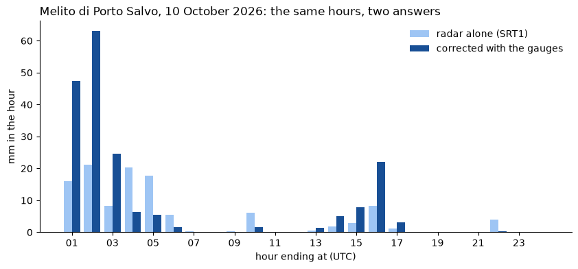
</p>

<p align="center">
  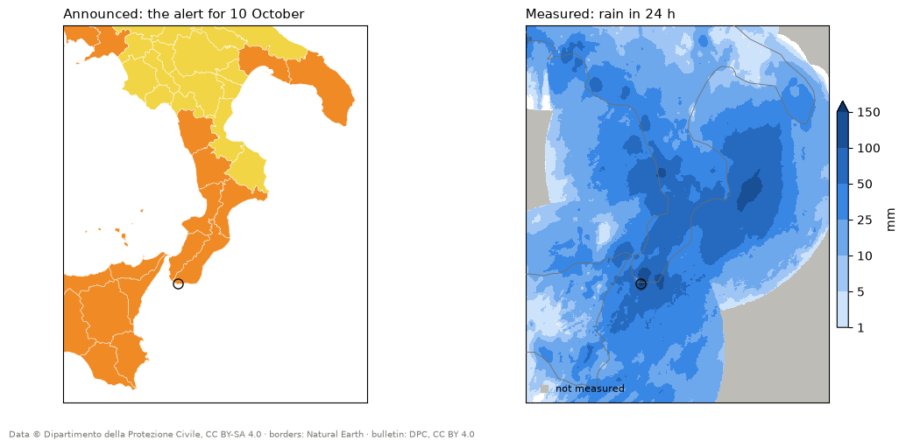
</p>

And four small programs in [`examples/`](https://github.com/agent-engineering-studio/dpc-radar/blob/main/examples), each one file:

| Program | What it does | Run it |
|---|---|---|
| [`rain_at.py`](https://github.com/agent-engineering-studio/dpc-radar/blob/main/examples/rain_at.py) | the rain at a place: now, last 3–24 hours, official alert | `uv run python examples/rain_at.py 12.50 41.90 --name Roma` |
| [`storm_watch.py`](https://github.com/agent-engineering-studio/dpc-radar/blob/main/examples/storm_watch.py) | watches an area and tells you when a violent shower enters it | `uv run python examples/storm_watch.py --rate 30` |
| [`nightly_archive.py`](https://github.com/agent-engineering-studio/dpc-radar/blob/main/examples/nightly_archive.py) | keeps your archive up to date; made for cron | `uv run python examples/nightly_archive.py ~/radar-archive` |
| [`app.py`](https://github.com/agent-engineering-studio/dpc-radar/blob/main/examples/app.py) | a rain dashboard for any town, in the browser | `uv run --group examples streamlit run examples/app.py` |

<p align="center">
  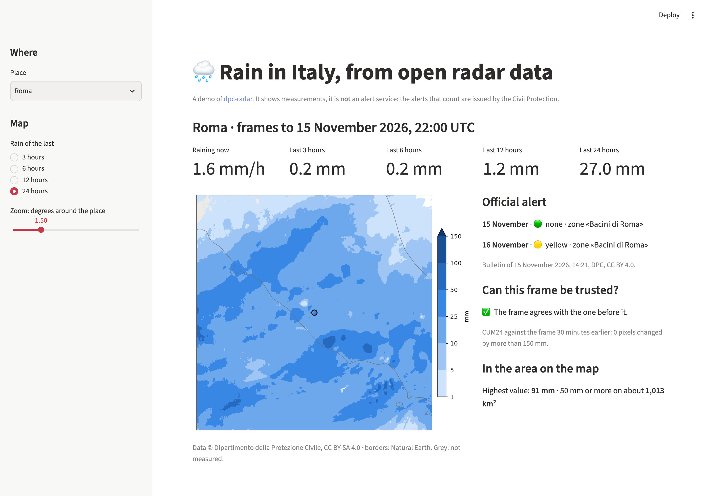
</p>

---

## Quick start

### 1. Install

```bash
pip install dpc-radar
```

Python 3.12 or newer. It depends on `httpx`, `numpy` and `rasterio`.

No account and no key: the DPC data are open.

### 2. Get the latest frame

```python
import asyncio

from dpc_radar import RadarClient


async def main() -> None:
    async with RadarClient() as radar:
        rain = await radar.latest("CUM24")
    print(rain.product.name, rain.time)  # CUM24 2026-11-04 14:00:00+00:00
    print(rain.data.shape)  # (1233, 1341): 0.01° pixels, NaN where the radar does not see


asyncio.run(main())
```

### 3. Read the rain at a place

```python
melito, reggio = (15.78, 37.92), (15.65, 38.11)  # lon, lat in degrees
print(rain.sample([melito, reggio]))  # mm in the last 24 hours, or None if not measured
print(rain.peak((15.25, 37.75, 17.25, 39.45), threshold=50))  # (highest mm, pixels >= 50)
```

`sample` reads the **median of the 3×3 pixels** around each point, never one
pixel, and answers `None` where the radar has no data: not measured is not
the same as dry.

### 4. Check a frame before you trust it

```python
async with RadarClient() as radar:
    now = await radar.latest("CUM24")
    before = await radar.at("CUM24", now.time - now.product.period)  # 30 minutes earlier

check = now.check(before, max_step=150)  # mm: more than half an hour of rain
if check.grid is None:
    rain = before  # rejected: this frame jumped up where no rain can fall that fast
else:
    rain = check.grid  # consistent, or the frame before was the wrong one
print(check.verdict, check.jumps)
```

A frame older than about five months is gone: `radar.at(...)` returns
`ABSENT` instead of raising, and never retries it.

`check` only sees what moves between two frames. `quality` asks more, and says
why it does not trust a pixel:

```python
from datetime import timedelta

from dpc_radar import ABSENT, radar_total

async with RadarClient() as radar:
    cum3 = await radar.latest("CUM3")
    hours = [await radar.at("SRT1", cum3.time - timedelta(hours=h)) for h in range(3)]

# the radar alone over the same three hours; with an hour missing, no comparison
seen = None if any(h is ABSENT for h in hours) else radar_total(hours)
q = cum3.quality(radar=seen)
print(q.score, q.reasons)
rain = q.grid  # the frame without the pixels not trusted; None if the frame is rejected
```

On the frame of 7 October 2026, 06 UTC, it prints
`0.996 {'jump': 0, 'beyond_record': 0, 'outlier': 0, 'gauge_only': 356}`:
356 pixels of rain from a gauge that was stuck.

| Reason | The rule | It needs |
|---|---|---|
| `jump` | `check` against the frame before: the only rule that rejects a whole frame | `previous` |
| `beyond_record` | more than the most rain ever measured in Italy over the window (948 mm in 24 h, 181 mm in 1 h), plus 25 % | nothing |
| `outlier` | a pixel at least 50 mm above the 5×5 pixels around it, and ten times their spread | nothing |
| `gauge_only` | a «Merging» frame with 30 mm or more where the radar alone saw less than 5 % of it within 2 km, at a place the radar sees well | `radar` |

These are rules, not a trained model: there are too few labelled cases to
train one. Each has a threshold measured on the 2,550 frames kept from June to
November 2026. In those months the last rule found rain gauges reporting rain
under a dry sky in 154 of 1,270 three-hour frames, mostly at the same seven
places. Where the radar is blind, as on Lipari, a gauge is all there is and
its rain is kept.

### 5. Look at it

With `pip install matplotlib`:

```python
import matplotlib.pyplot as plt

h, w = rain.data.shape
left, top = rain.transform.c, rain.transform.f
right, bottom = left + w * rain.transform.a, top + h * rain.transform.e
plt.imshow(rain.data, extent=(left, right, bottom, top), cmap="Blues", vmin=0, vmax=50)
plt.colorbar(label="rain in the last 24 hours (mm)")
plt.show()
```

### Without the client

Every step is also a plain function, if you have your own HTTP stack:
`products.last_product_url`, `parse_last_product`, `products.download_body`,
`parse_download`, `is_expired`, then `RainGrid.from_geotiff(raw, product, time)`.

---

## Keep the «Merging», read fifteen years of history

The DPC keeps about **five months** of frames. The «Merging», the rain
corrected with the gauges, has no public archive: whatever you do not save in
time is gone. `dpc_radar.archive` keeps your own copy and turns it into
**hourly rain** at any point.

```python
from datetime import UTC, datetime, timedelta
from pathlib import Path

from dpc_radar import RadarClient
from dpc_radar.archive import MergingArchive, archive

folder = Path("radar-archive")
now = datetime.now(UTC)
async with RadarClient() as radar:  # run it every night: it only fetches what is missing
    report = await archive(folder, radar, start=now - timedelta(days=150), end=now, limit=1500)
print(report)  # ArchiveReport(downloaded=..., present=..., lost=..., failed=..., bytes=...)

rain = MergingArchive(folder).hourly(
    [(15.78, 37.92)], datetime(2026, 10, 10, 0, tzinfo=UTC), datetime(2026, 10, 10, 6, tzinfo=UTC)
)
# {01:00: [47.4], 02:00: [63.0], 03:00: [24.6], 04:00: [6.3], 05:00: [5.5], 06:00: [1.7]}
```

It keeps two products: `CUM3` (radar and gauges, every three hours) and
`SRT1` (radar alone, every hour). The rain of one hour is the radar's hour
rescaled so that the three hours add up to the «Merging»: **the gauges say how
much, the radar says when**. Oldest frames are fetched first, since they are
the next to disappear; frames the DPC no longer has are written down and never
asked again.

For the years before, there is **IT-DPC-SRI**: the national radar mosaic from
2010 to 2025, every 5–15 minutes, published on
[Zenodo](https://doi.org/10.5281/zenodo.18637608) as one 50 GB archive. Unpack
it once, and read it with the same call:

```python
from dpc_radar.history import SriHistory  # pip install "dpc-radar[history]"

history = SriHistory(Path("italian-radar-dpc-sri.zarr"))
rain = history.hourly(
    [(15.78, 37.92)], datetime(2015, 11, 1, tzinfo=UTC), datetime(2015, 11, 2, tzinfo=UTC)
)
```

It is **radar only**: where both exist, compare it with the «Merging». Fewer
than one frame in a thousand is corrupted, and `hourly` reads those as
missing. And it is **not one series**: until 2017 the mosaic read about two
thirds of what it reads since 2018, so do not carry a threshold across that
year.

---

## Where the radar can be trusted

A radar that reads zero is not always a dry sky. On 10 October 2026 a
cloudburst hit Lipari and the mosaic showed almost nothing: the nearest beams
pass 3,500 m above the island. `reliability` says so before the storm:

```python
from dpc_radar import reliability

r = reliability(14.95, 38.47)  # Lipari
r.score  # 0.42: below 0.5, do not read a radar zero as "dry"
r.visibility  # 0.42  the lowest beam is high above the ground...
r.beam_height  # 3550.0 metres
r.coverage  # 0.88  ...the radars that reach it were on 88 % of the time
r.agreement  # None  no gauges at sea to compare with
r.nearest_site  # 'Catania Fontanarossa', 112 km away (r.distance_km)
```

<p align="center">
  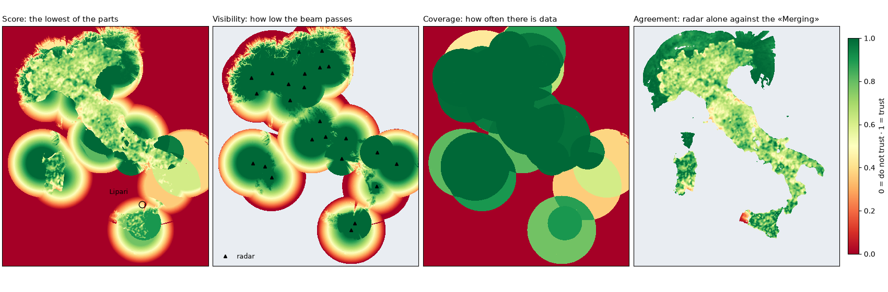
</p>

The score is the lowest of three parts, each between 0 and 1:

| Part | What it measures | Where it is low |
|---|---|---|
| `visibility` | the height of the lowest beam that reaches the point without being cut by a mountain (1 up to 1,500 m, 0 from 5,000 m) | far from every radar, behind the Alps and Etna, the islands |
| `coverage` | the share of the hourly frames in which the mosaic has data there | Calabria and Apulia (radars on about half of the time, June–November 2026); the west of Sicily, never covered: score 0 |
| `agreement` | the rain of the radar alone (SRT1) against the «Merging» (CUM3), as the smaller of the two ratios | around Palermo the radar read 11 % of the gauge-corrected rain |

`reliability_map().like(grid)` gives the score on the pixels of any frame, and
`SITES` lists the 24 radars. The map is an estimate made from outside: the DPC
publishes neither a quality map nor the gauges of the «Merging». Seven radar
positions come from the DPC's own table; the others were found by fitting
their range circles on the mosaic. `coverage` and `agreement` describe the five
months the map was built on.

## How far the radar alone is from the «Merging»

The radar-only products (`SRI`, `SRT1`) come every 5 minutes, the «Merging»
every 30. So it is tempting to use the radar alone. From June to November 2026
it read **20 % more rain** than the «Merging» (33 % more on land) and passed
30 mm in three hours **70 % more often**. Not everywhere in the same direction:

<p align="center">
  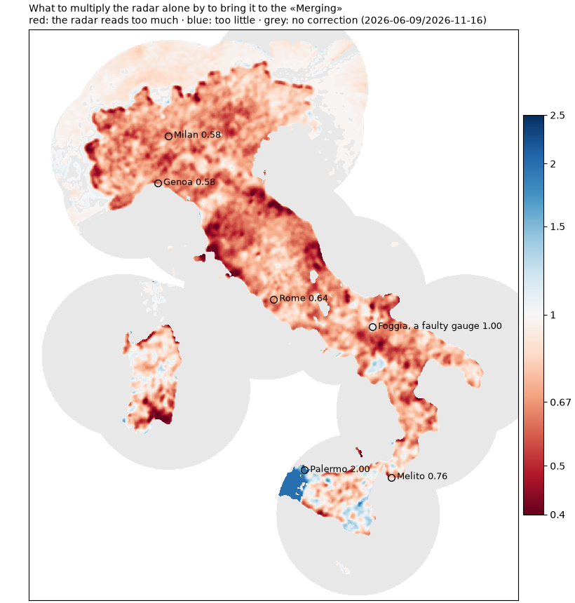
</p>

```python
from dpc_radar import correct, radar_factor

radar_factor(12.5, 41.9)  # 0.64  Rome: the radar reads 1.6 times the «Merging»
radar_factor(13.36, 38.12)  # 2.0  Palermo: it reads less than half
radar_factor(13.0, 40.5)  # 1.0  open sea: no gauges, nothing to correct with

srt1 = await radar.latest("SRT1")
closer = correct(srt1)  # the same frame, times the factor of every pixel
```

The factor is the rain of `CUM3` over the rain of the three `SRT1` hours of the
same window, summed over five months and over 9 km. Measured by correcting
every month with the map of the other months:

| Three-hour rain against the «Merging» | Mean error | Total | Passes 30 mm | Passes 50 mm |
|---|---|---|---|---|
| radar alone | 1.91 mm | 1.20 | 1.70 times as often | 1.81 |
| one factor for the whole of Italy | 1.94 mm | 0.99 | 0.94 | 0.87 |
| **the factor map** | **1.55 mm** | **1.00** | **0.89** | **0.84** |

**What it is not.** It cannot find rain the radar did not see: zero times a
factor is zero. It corrects how much, not where. It **lowers heavy rain**:
where the «Merging» has 30 mm or more, the radar alone reads 0.91 of it and
the corrected radar 0.75, and in July and August it passes 30 mm half to two
thirds as often as the «Merging». Use it for totals and for how often a
threshold is passed over a season, not for the peak of one storm. In Sicily it
helps little. It was measured on three-hour windows of 2026, and it is **not
applied to the 2010–2025 history**: there is no «Merging» of those years to
test it on. A model with more inputs (gradient boosting) was tried and
dropped: about the same mean error, but it almost never reached 100 mm. The
[full table](https://agentengineering.it/dpc-radar/api/bias/), by region, by
intensity and by month, is in the reference.

## How rare is this rain, here

A hundred millimetres in a day are a rain of most years in Genoa and one of a
generation in Bari. `rarity` says how rare a rain of 1, 3, 6 or 24 hours is at
a place, from a map that ships with the package:

<p align="center">
  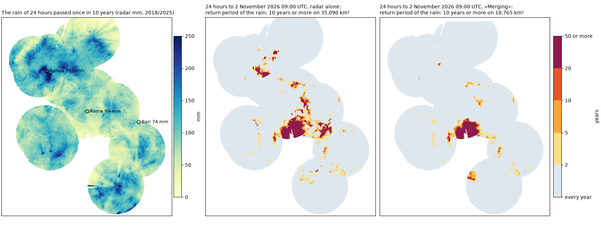
</p>

```python
from dpc_radar import radar_total, rarity, return_level, return_period

rarity(24, 8.93, 44.41, 100.0).return_period  # 1.7   Genoa: most years
rarity(24, 16.87, 41.12, 100.0)  # Bari: 32 years (between 9 and 50 or more), percentile 99.99
return_level(24, 8.93, 44.41, 10)  # Level(mm=203.1, low=166.6, high=264.1)

srt1 = await radar.latest("SRT1")
years = return_period(srt1)  # the return period of every pixel of the last hour
day = return_period(radar_total(last_24_hours), 24)  # of a sum of hourly frames
```

The map is a GEV distribution of the highest window of each year, in cells of
5 km, fitted on the hourly rain of the IT-DPC-SRI history from **2018 to
2025**. Not from 2010: until 2017 the mosaic read about two thirds of what it
reads now, and a map on all sixteen years calls ordinary today's rain rare.

**How far to trust it.** Eight years are few. Fitted on six and asked about
the other two, what the map calls "10 years" came about every 7 and "20 years"
every 13; nothing is given beyond 50 years. It is in **radar millimetres**:
the radar alone reads more than the rain gauges over most of the land, so
these levels are not those of the official rainfall curves, and a radar-only
frame brings its faults with it (in the image, the radar alone finds twice the
area of the «Merging»). Clean the frame with [`quality`](#4-check-a-frame-before-you-trust-it)
first. The [tables](https://agentengineering.it/dpc-radar/api/climatology/)
are in the reference.

## The official alert, as data

Every day by 16:00 the DPC publishes the **criticality bulletin**: the
official alert level of each of Italy's ~190 alert zones, for today and
tomorrow, for landslides, rivers and thunderstorms. It is already structured
data (GeoJSON, CC BY 4.0); `dpc_radar.bulletins` reads it.

```python
from dpc_radar import bulletins  # pip install "dpc-radar[bulletins]"

bulletin = await bulletins.latest()
for zone in bulletin.alerts():  # yellow or above, today, highest first
    print(zone.colour, zone.name, zone.hydrogeological, zone.hydraulic, zone.thunderstorms)
# orange Bacini Flumendosa - Flumineddu 2 0 1
# orange Gallura 2 0 1
# yellow Basi-B 1 0 0 ...

zone = bulletin.zone_at(15.78, 37.92)  # the zone of a point, with its municipalities
print(zone.name, zone.colour)  # Versante Jonico Meridionale yellow
```

Levels are numbers: 0 none, 1 yellow, 2 orange, 3 red. This is **the**
official alert: whatever you compute from the radar is not, and belongs next
to it, never in its place.

---

## How it works

### Two calls, and one surprise

The open API at `radar-api.protezionecivile.it` has two calls that matter.
The first says which frame is the newest; the second gives a short-lived
download link for one frame.

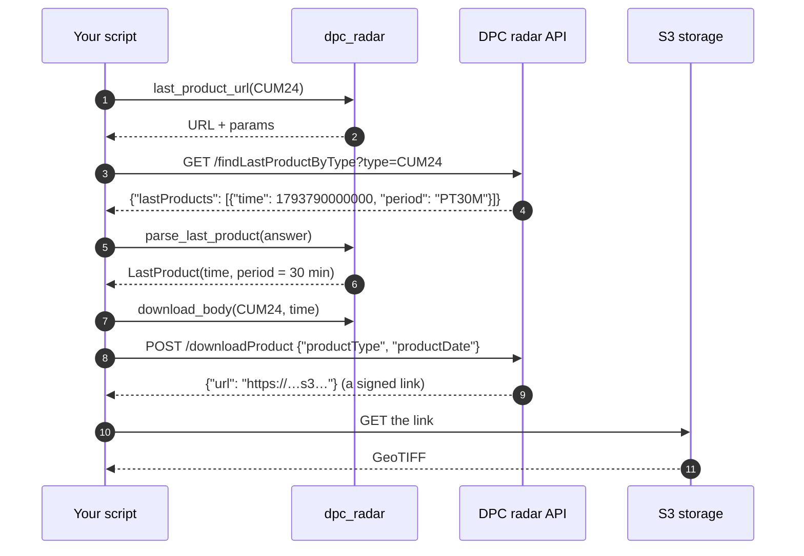

### What a frame request can answer

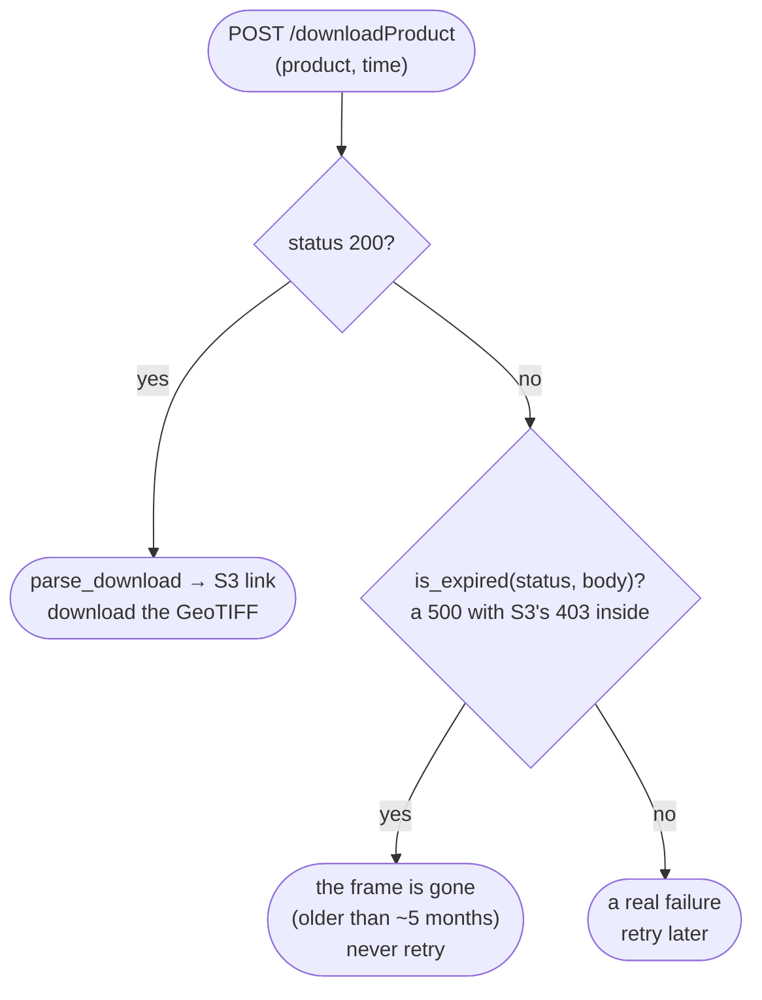

### The building blocks

Three layers. `products` is **pure**: it builds requests and reads answers,
with no network. `grid` turns a GeoTIFF into an array you can sample and
check. `client` wires them to **your** `httpx.AsyncClient`, so timeouts,
retries and proxies stay under your control.

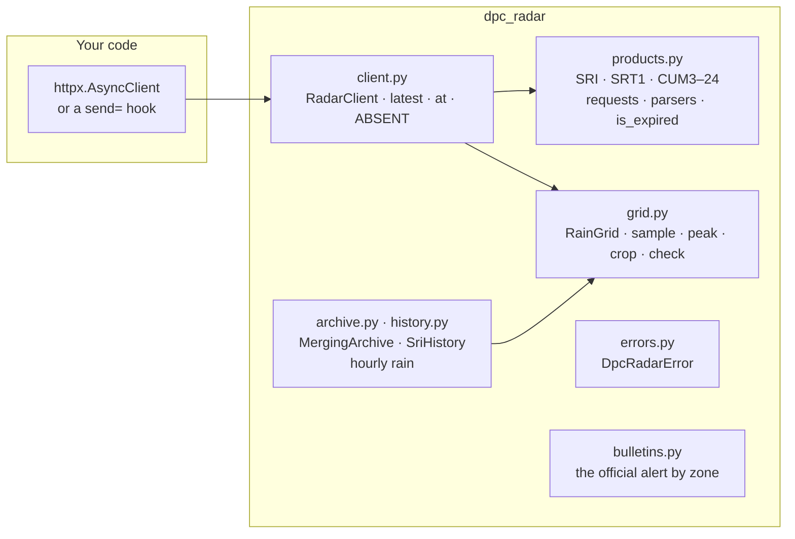

---

## The traps we already fell into

Every line below cost a bug in Limen. The library handles the ones it can;
the others are here so you don't have to find them yourself.

| Trap | What happens | What to do |
|---|---|---|
| **No `CUM1`** | asking for it gives an empty list, not an error | the shortest «Merging» is `CUM3`; for one hour use `SRT1` |
| **"Gone" looks like a crash** | a frame older than ~5 months answers **500**, with S3's `403 Forbidden` in the body, not 404 | `is_expired(status, body)`: never retry those |
| **The «Merging» disappears** | the DPC keeps about five months, and there is no public archive of it | `dpc_radar.archive`: save them every night, oldest first |
| **Two grids** | `SRI`/`SRT1` are 1 km in a Transverse Mercator projection; `CUM*` are 0.01° in EPSG:4326 | never mix the arrays: reproject one onto the other |
| **A corrupted series** | in October 2026 every CUM24 frame at :30 carried a smooth bell of up to 20,584 mm over Abruzzo, for days (the :00 frames were right) | never trust one frame alone: compare it with its neighbours, and read a place with the median of the 3×3 pixels around it |
| **Not every echo is rain** | sea clutter or a radar with a problem can paint rain where there is none. But a round edge alone proves nothing: it is where a radar's range ends | look at the hourly frames: rain moves, clutter stays |
| **A gauge can be wrong too** | on 6–8 October 2026 one gauge of the «Merging» was stuck: 126.6 mm every 3 hours for 33 hours on a dry night, 1,152 mm in `CUM24` | a jump between frames does not catch it; the radar alone (`SRT1`) read 0: `frame.quality(radar=...)` masks it |
| **Radar alone is not the truth** | the radar-only history read between 10 % and 80 % of the gauges in Apulia in 2016; in 2026 the radar alone read 20 % *more* than the «Merging», and up to 1.7 times in Milan and Genoa | use the «Merging» when you can; `correct(frame)` for the radar alone of 2026; compare on your area |
| **Times are in UTC, in milliseconds** | the API speaks epoch milliseconds | `to_epoch_ms` / `from_epoch_ms`, and always aware datetimes |
| **The `origin` header** | the API once refused requests without it; in November 2026 it no longer does | `products.HEADERS` sends it anyway |

Every trap above is a case in the **[benchmark](https://agentengineering.it/dpc-radar/benchmark/)**:
real frames where we know the answer, and how each cleaning rule scores on
them. Limen's rule today passes 14 of 30 checks; a frame-level check
(`jump-sign`) passes 26, 28 with the reliability map, and `quality` all 30.

---

## API at a glance

| Name | What it is |
|---|---|
| `RadarClient(client=None, send=None, retries=3)` | the client: `async with`, your `httpx.AsyncClient` or a `send` hook |
| `radar.latest(p, cached=None)` | the newest frame as a `RainGrid`; `cached` skips the download if it is still the newest |
| `radar.at(p, time)` / `radar.download(p, time)` | the frame issued at `time` as a grid / as GeoTIFF bytes, or `ABSENT` |
| `radar.last_product(p)` | time and period of the newest frame |
| `RainGrid` | one frame: `product`, `time`, `data` (NaN = no data), `transform`, `crs` |
| `grid.sample(points)` | the value at lon/lat points: median of the 3×3 pixels, `None` if not measured |
| `grid.peak(bbox, threshold=)` / `grid.crop(bbox)` | highest value and pixels above a threshold in a box / the box as a grid |
| `grid.check(previous, max_step=)` | `FrameCheck(verdict, grid, jumps)`: whether to trust a frame, given the one before |
| `grid.quality(previous=None, radar=None)` | `Quality(grid, mask, reasons, score, verdict)`: what to trust pixel by pixel, and why |
| `radar_total(frames)` | the radar-only rain over a window: the sum of its hourly `SRT1` frames |
| `ABSENT` | a frame the DPC no longer keeps |
| `archive(folder, radar, start=, end=, limit=)` | download the CUM3 and SRT1 frames the archive lacks; an `ArchiveReport` |
| `MergingArchive(folder).hourly(points, start, end)` | hourly rain per point from the archive: SRT1 rescaled to the CUM3 |
| `SriHistory(zarr).hourly(points, start, end)` | the same from IT-DPC-SRI, 2010–2025, radar only (extra `history`) |
| `reliability(lon, lat)` / `reliability_map()` | how much to trust the radar at a point: `score`, `visibility`, `coverage`, `agreement`, `beam_height`, `reliable` / the whole map, `.like(grid)` on the pixels of a frame |
| `SITES` | the 24 radars of the mosaic: position, altitude, band, range |
| `correct(grid)` / `radar_factor(lon, lat)` / `bias_map()` | a radar-only frame times the factor «Merging» / radar of every pixel / the factor at a point (1.0: no correction) / the whole map, `.like(grid)` |
| `rarity(window, lon, lat, mm)` / `return_level(window, lon, lat, years)` / `return_period(grid, window=None)` | how rare a rain of 1, 3, 6 or 24 hours is at a point: `return_period` with `low` and `high`, `percentile`, `years` / the rain of a return period, a `Level(mm, low, high)` / the return period of every pixel of an accumulation frame; `climatology()` is the whole map |
| `bulletins.latest()` / `bulletins.fetch(name)` | the official criticality bulletin: `Bulletin.zones`, `.alerts()`, `.zone_at(lon, lat)` (extra `bulletins`) |
| `SRI`, `SRT1`, `CUM3`, `CUM6`, `CUM12`, `CUM24` | the products: `name`, `hours` (`None` for an intensity), `merging`, `description` |
| `PRODUCTS`, `product(name)` | every product by name; `product("cum24")` → `CUM24` |
| `products.last_product_url(p)` | URL and params of the "latest frame" request (a `GET`) |
| `products.download_url()`, `products.download_body(p, at)` | URL and JSON body of the "download link" request (a `POST`) |
| `parse_last_product(answer)` | `LastProduct(product, time, period)`, or `None` if the API lists none |
| `parse_download(answer)` | the signed S3 link of a frame |
| `is_expired(status, body)` | `True` when the frame is gone for good |
| `products.HEADERS`, `products.NODATA` | the `origin` header; `-9999.0`, the no-data value of every product |
| `products.to_epoch_ms`, `from_epoch_ms`, `parse_period` | the API's times and periods (`PT5M`, `PT30M`) |
| `DpcRadarError` | an answer the library cannot read, or a bad argument |

Full reference: **https://agentengineering.it/dpc-radar/api/client/**

---

## Roadmap, and where AI helps

The plan is on the [roadmap](https://agentengineering.it/dpc-radar/roadmap/)
and tracked in [#10](https://github.com/agent-engineering-studio/dpc-radar/issues/10).
Each idea is measured against one goal of
[Limen](https://github.com/agent-engineering-studio/limen): anticipate within
72 hours 90 % of the events in the news, with at most 10 % of
municipality-days on alert.

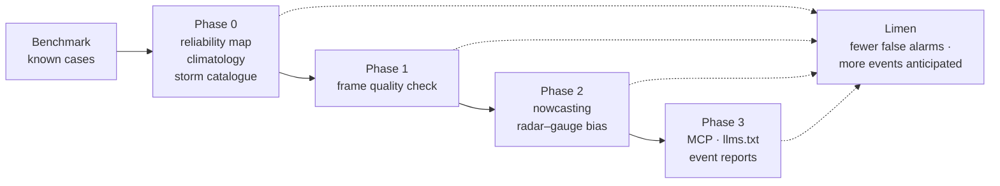

| Idea | In plain words | What Limen gains | Issue |
|---|---|---|---|
| **Benchmark** | a fixed set of storms and faults where we know the answer | every change measurable | [#2](https://github.com/agent-engineering-studio/dpc-radar/issues/2) |
| **Reliability map** | where the radar sees well, and where it is blind | a blind spot is no longer read as "dry" | [#3](https://github.com/agent-engineering-studio/dpc-radar/issues/3) |
| **Rain climatology** ✅ | how rare is this rain *here*, from eight years of radar (2018–2025) | rain judged against the place, not against one national threshold; the effect on Limen's alerts is still to measure | [#4](https://github.com/agent-engineering-studio/dpc-radar/issues/4) |
| **Storm catalogue** | every storm as an object, and the extreme ones as events to check in the news | many more verified events to measure against | [#5](https://github.com/agent-engineering-studio/dpc-radar/issues/5) |
| **Frame quality check** ✅ | rules that tell a real storm from a broken frame or a faulty gauge, and say why | fewer false alarms | [#6](https://github.com/agent-engineering-studio/dpc-radar/issues/6) |
| **Nowcasting** | the rain field moved forward along its motion, 0–2 hours | a trigger on rain that is *coming* | [#7](https://github.com/agent-engineering-studio/dpc-radar/issues/7) |
| **Radar–gauge bias** ✅ | how far the radar alone is from the «Merging», place by place, and a factor for it | radar-only rain closer to the «Merging» between two frames; the history is still open | [#8](https://github.com/agent-engineering-studio/dpc-radar/issues/8) |
| **AI for agents** | an MCP server, `llms.txt`, reports that cite their frames | the same facts for Limen's assistant | [#9](https://github.com/agent-engineering-studio/dpc-radar/issues/9) |

One rule holds for every AI feature: **the numbers come from the frames**,
computed by tested code. A language model may read the news and explain the
numbers, never invent them, and nothing here replaces the official DPC alert.

---

## Contributing

Contributions of every size are welcome, from a typo to a new module. You
don't need to be a meteorologist: most of the code is plain Python, HTTP and
arrays.

```bash
git clone https://github.com/agent-engineering-studio/dpc-radar
cd dpc-radar
uv sync          # install everything, dev tools included
make check       # ruff + mypy --strict + pytest, the same gate as CI
make docs        # build this site locally
```

The tests **need no network**: they run against answers recorded from the
real API.

```text
dpc-radar/
├── src/dpc_radar/
│   ├── products.py   # products, requests, parsers, is_expired: pure functions
│   ├── grid.py       # RainGrid: read a frame, sample, peak, crop, check, quality
│   ├── client.py     # RadarClient: latest, at, download, ABSENT
│   ├── archive.py    # archive the «Merging», hourly rain from it
│   ├── history.py    # IT-DPC-SRI 2010-2025 (extra [history])
│   ├── bulletins.py  # the official criticality bulletin (extra [bulletins])
│   ├── reliability.py  # where the radar can be trusted: a map and its parts
│   ├── quality.py    # what to trust in a frame, pixel by pixel, and why
│   ├── bias.py       # how far the radar alone is from the «Merging», and a factor
│   ├── climatology.py  # how rare a rain is at a place: percentile and return period
│   └── errors.py     # DpcRadarError
├── tests/            # offline: synthetic GeoTIFFs and a fake API
│   └── live/         # the same on the real API: uv run pytest -m live
├── benchmarks/       # known cases, and how each cleaning rule scores
├── tools/            # build_reliability.py, build_bias.py, build_climatology.py: the maps
└── docs/
    ├── make_images.py  # the images of this README, from real frames
    └── roadmap.md      # what comes next, and where AI helps
```

Good first issues: a notebook with a storm you remember, a recipe for your
favourite HTTP library, a check of the radar against a rain gauge near you.
See [CONTRIBUTING.md](https://github.com/agent-engineering-studio/dpc-radar/blob/main/CONTRIBUTING.md).
Questions, ideas and maps you made go in the organisation's
[discussions](https://github.com/orgs/agent-engineering-studio/discussions).

---

## Data licence and credits

- **Radar data** (SRI, SRT1, «Merging» CUM): © *Dipartimento della
  Protezione Civile*, open data under
  [CC BY-SA 4.0](https://creativecommons.org/licenses/by-sa/4.0/). Credit the
  DPC and share data you derive from it under the same licence.
- **Criticality bulletins**: DPC, [CC BY 4.0](https://creativecommons.org/licenses/by/4.0/).
- **IT-DPC-SRI** (the 2010–2025 history, read by the `history` module):
  Fondazione Bruno Kessler on DPC data, CC BY-SA 4.0,
  [doi:10.5281/zenodo.18637608](https://doi.org/10.5281/zenodo.18637608).
- **The reliability map** (`src/dpc_radar/data/reliability.tif`) is derived
  from the DPC radar data and so is under CC BY-SA 4.0, not Apache-2.0. Its
  terrain comes from the [Terrain Tiles](https://registry.opendata.aws/terrain-tiles/)
  of Mapzen on AWS Open Data (SRTM, EU-DEM and other open sources; see their
  [attribution](https://github.com/tilezen/joerd/blob/master/docs/attribution.md)).
  Radar positions: DPC, *Rete Radar Nazionale*, technical annex.
- **The bias map** (`src/dpc_radar/data/bias.tif`) is derived from the DPC
  radar data too: CC BY-SA 4.0.
- **The climatology** (`src/dpc_radar/data/climatology.tif`) is derived from
  IT-DPC-SRI: CC BY-SA 4.0, credit the DPC and Fondazione Bruno Kessler.
- **Country borders** in the images: [Natural Earth](https://www.naturalearthdata.com/), public domain.

This library is not affiliated with the DPC. It is not an alert system:
for official warnings, see the
[DPC criticality bulletin](https://rischi.protezionecivile.gov.it/it/meteo-idro/allertamento/)
and your regional civil protection.

The code is released under the [Apache-2.0](https://github.com/agent-engineering-studio/dpc-radar/blob/main/LICENSE) licence.
