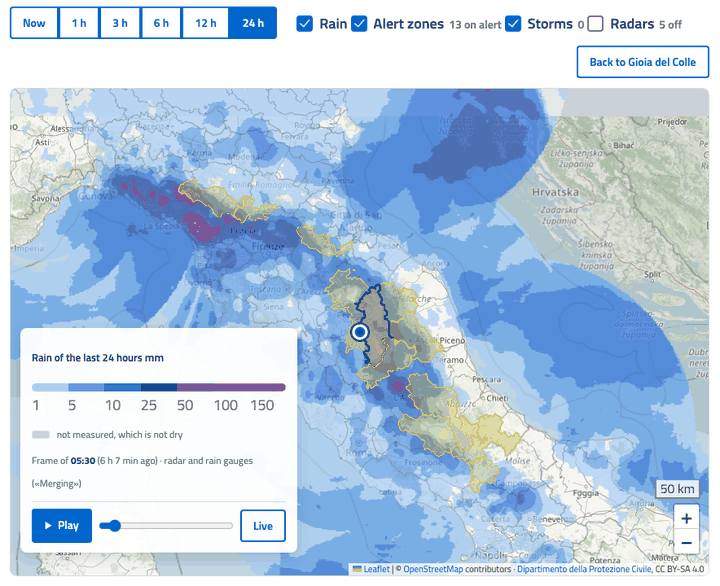
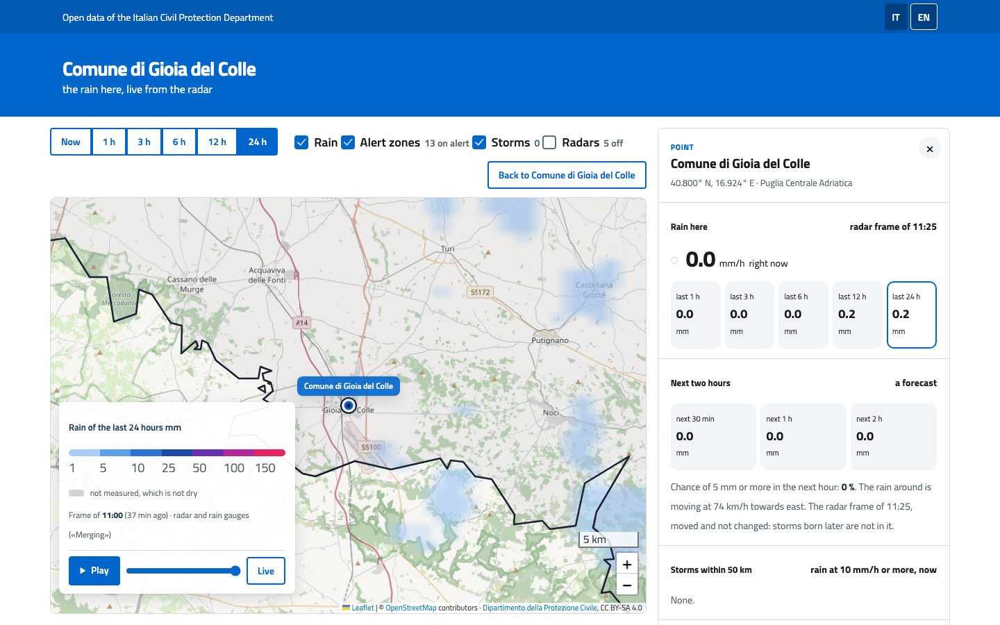

# The demo

A live map of the rain, on OpenStreetMap, made to sit on the site of a public
body: it opens on the place you give it, or on Gioia del Colle, in Apulia. Click a point, an alert
zone, a storm or a radar, and a card shows what dpc-radar knows about it. It is here to show the library at work, and to be copied from: every card
has the lines of Python that give it.


**Play**, under the legend, shows how the rain moved: the last thirteen frames
of the layer, one every ten minutes for the rain rate, one every thirty for
the sums. The slider stops on a frame; **Live** goes back to the newest one.



## Run it

With Docker, from the root of the repository:

```bash
docker compose up
docker compose down      # stop it and remove the containers (or: make down)
```

With [uv](https://docs.astral.sh/uv/) and [Node](https://nodejs.org/) 20 or
later:

```bash
scripts/init.sh
make demo
```

Then open http://localhost:3000.

## On the site of a municipality

Give the page the coordinates of the place, and it opens there: the name in
the header, a marker on the point, and the card of that point already open.

```bash
DPC_RADAR_LAT=40.7997 DPC_RADAR_LON=16.9236 \
DPC_RADAR_PLACE="Comune di Gioia del Colle" docker compose up
```



| Variable | What it does | Without it |
|---|---|---|
| `DPC_RADAR_LAT`, `DPC_RADAR_LON` | where the map opens, in decimal degrees | Gioia del Colle |
| `DPC_RADAR_ZOOM` | the zoom it opens at, 5 to 13 | 11 with coordinates, 10 without |
| `DPC_RADAR_PLACE` | the name in the header and on the marker | "dpc-radar" |
| `DPC_RADAR_LAYER` | what the map shows first: `now`, `1`, `3`, `6`, `12` or `24` | `now` |
| `DPC_RADAR_TILES`, `DPC_RADAR_TILES_CREDIT` | the tiles of the background map, and their credit | OpenStreetMap |

The same can go in the address, to put the page inside another one:
`/?lat=40.7997&lon=16.9236&place=Comune%20di%20Gioia%20del%20Colle&layer=24`
(`frame=0` to `12` opens on one of the older frames of the film).
Coordinates outside Italy are ignored. **Back to …**, over the map, returns to
where it opened.

The page is built with [Bootstrap Italia](https://italia.github.io/bootstrap-italia/),
the interface kit of the Italian public administration, served by the page
itself: the only call the browser makes to someone else is for the tiles of
the background map. What stays with whoever publishes it is in
[Riuso nella PA](https://agentengineering.it/dpc-radar/riuso/).

## What is in it

The map shows the rain of now (mm/h) or of the last 1, 3, 6, 12 or 24 hours
(mm), and over it three layers one can switch off:

| Click | The card shows | From |
|---|---|---|
| any point | the rain now and in the last 1 to 24 hours, how rare it is there, the rain of the next two hours and the chance of it, the storms within 50 km, how far the radar can be trusted there | `RainGrid.sample`, `rarity`, `nowcast`, `chance`, `reliability` |
| an alert zone | the official alert of the DPC bulletin, day by day, and the rain over the whole zone | `bulletins.latest`, `facts.describe` |
| a storm | its peak, its area, where it is going and how fast | `storms`, `motion` |
| a radar | whether it is on, and the rain inside its range | `SITES`, `radar_status` |

Grey on the map is where nothing was measured, which is not the same as dry.
The radars are drawn when you tick them; the storms are those of now, so the
film hides them.

The page is in Italian and in English: it opens in the language of the
browser, and **IT | EN** at the top of the panel changes it. The words are in
[`web/lib/i18n.ts`](web/lib/i18n.ts).

## How it is made

| Folder | What it is |
|---|---|
| [`api.py`](api.py) | a small API over the library (Starlette): the rain as a picture, the zones, the storms and the radars as GeoJSON, the numbers of a point |
| [`web/`](web) | the page (Next.js, Leaflet, Bootstrap Italia): it draws the map and asks the API, through its own `/api/*` |

Everything is read live from the DPC: no key, no account, nothing on disk.
Frames are kept in memory; the newest is asked for again every two minutes,
the bulletin every fifteen. The API has its own URLs to try:

```bash
curl 'http://localhost:3000/api/point?lon=12.5&lat=41.9'
curl 'http://localhost:3000/api/storms'
curl 'http://localhost:3000/api/film/now'
```

`DPC_RADAR_PORT` changes the port of the page; `DPC_RADAR_API` tells the page
where the API is (default `http://127.0.0.1:8000`).

This is a demo of a library, not an alert service. For official warnings see
the DPC bulletin and your regional civil protection.
