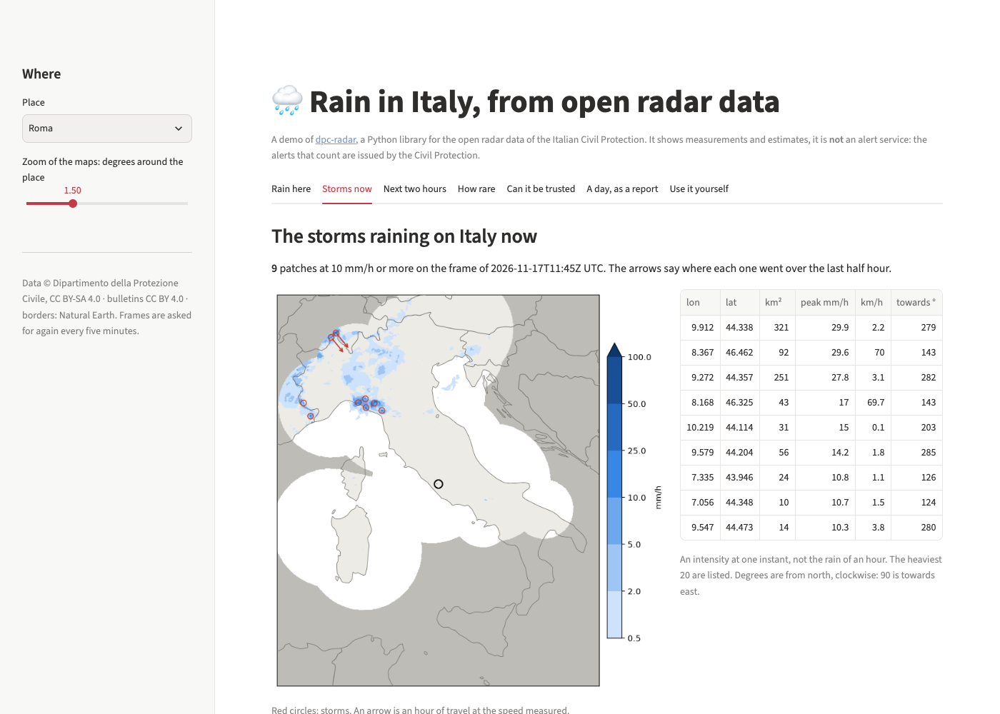

# The demo

One page in the browser that shows what dpc-radar can tell about a place in
Italy. It is here to show the library at work, and to be copied from: every
tab has the lines of Python that made it and the data they returned.



## Run it

With Docker, from the root of the repository:

```bash
docker compose up
```

With [uv](https://docs.astral.sh/uv/):

```bash
scripts/init.sh
make demo
```

Then open http://localhost:8501.

## What is in it

| Tab | What you see | From |
|---|---|---|
| Rain here | the rain now and in the last 1 to 24 hours, the map, the official alert, the check of the frame | `Facts.rain_at`, `area_summary`, `official_alert` |
| Storms now | every storm raining on Italy, and where it is going | `Facts.storm_now` |
| Next two hours | the rain to come and the chance of it, as a forecast | `Facts.rain_ahead`, `rain_ahead` |
| How rare | the rain that comes back once in 2 to 50 years at that place | `return_level`, `rarity` |
| Can it be trusted | how well the radar sees that place, the map for all of Italy, and the radars the DPC viewer reports as off | `reliability`, `radar_factor`, `radar_status` |
| A day, as a report | a whole day from the frames on disk: totals, maps, the text | `report.build`, `MergingArchive` |
| Use it yourself | where to start: Python, the shell, an assistant | |

## Where the data come from

The first five tabs read live from the DPC API: no key, no account. Frames are
kept in memory and asked for again every five minutes, the bulletin every
half hour.

The report reads the frames kept on disk, in `$DPC_RADAR_DATA/archive`
(`./data/archive` without Docker, the volume `radar-data` with it).
`scripts/fetch-data.sh` fills it with the last two days; run it again, or
`dpc-radar archive data/archive --days 7`, to have more.

| File | What it is |
|---|---|
| [`app.py`](app.py) | the page |
| [`borders.py`](borders.py) | the country outlines of the maps (Natural Earth, public domain), downloaded once |

This is a demo of a library, not an alert service. For official warnings see
the DPC bulletin and your regional civil protection.
