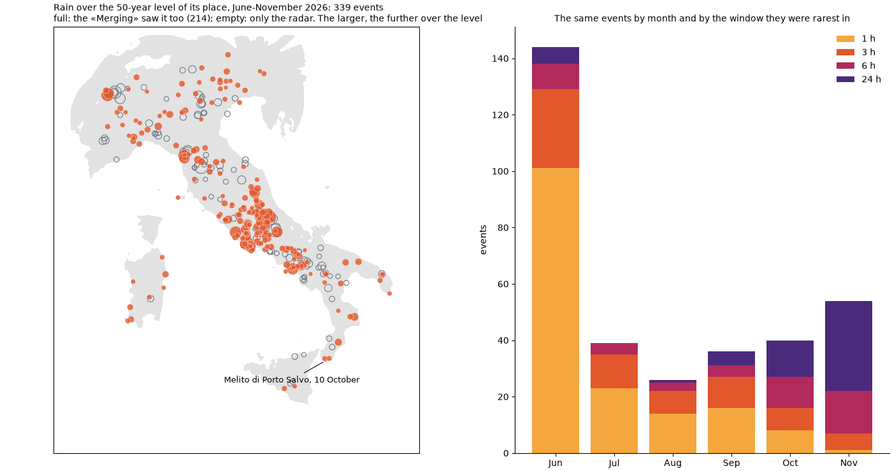

# Catalogue of rare rain

::: dpc_radar.catalogue

## The measure, in full

`uv run python -m tools.build_catalogue --archive <folder of archive()> --out
events.csv`, on the hourly SRT1 frames from 9 June to 16 November 2026
(160 days; 3,825 hours read, 12 missing, 4 rejected by `quality`). The land is
the alert zones of the criticality bulletin; the pixels are those with a
reliability of 0.5 or more; an event is at least 10 km². The list is
[rare-rain-2026.csv](../data/rare-rain-2026.csv) (CC BY-SA 4.0, derived from
the DPC radar data).

### How many

| Return period | Events | A month | Confirmed by the «Merging» | Not confirmed | Unknown |
|---|---|---|---|---|---|
| 10 years or more | 1,689 | 317 | 1,054 | 586 | 49 |
| 20 years or more | 763 | 143 | 474 | 260 | 29 |
| 50 years (the ceiling) | 339 | 64 | 214 | 109 | 16 |

"Confirmed" is: over the three-hour blocks that cover the window, the
«Merging» has at least half of what the radar alone has, within 0.05° of the
point. "Unknown" is a block missing from the archive. Without the land mask
the events over the 10-year level are 2,316.

The events at the ceiling by month: 144 in June (101 of them of one hour),
about 39 in July, 26 in August, 36 in September, 40 in October, 54 in the
first half of November (most of them of 24 hours). Of the first hundred of
the list, 63 are of one hour and 55 are of June, many in one cluster over the
central Apennines: short summer storms, where hail can make the radar read
more than the rain. The catalogue cannot tell; the «Merging» column and the news can.

### Why the list is long

A return period is about one place, and Italy is many places: somewhere a
"10-year" rain falls most weeks. And on the SRT1 of 2026
the levels are passed more often than their name says. The share of reliable
pixels over a level at least once in the 160 days:

| Window | 2 years | 10 years | 50 years |
|---|---|---|---|
| 1 h | 49.1 % | 11.8 % | 2.4 % |
| 3 h | 53.4 % | 15.3 % | 3.6 % |
| 6 h | 52.7 % | 15.9 % | 4.3 % |
| 24 h | 54.8 % | 19.8 % | 6.9 % |
| a whole year, if the name were exact | 50 % | 10 % | 2 % |

In 160 days the pixels over their 10-year level are already as many as, or
more than, a whole year should give. June to November holds most of the
highest rains of the year, so the gap with a whole year is smaller than the
days suggest; but the 24-hour level of 50 years is passed more than three times too often
even so.
A wet season, or an SRT1 that reads more than the history the map was fitted
on: one season cannot tell. So **read the return period as a ranking** (this
rain is among the heaviest this place has seen on the radar), not as "once in
N years".

### The events we knew

| Event | In the list | Why |
|---|---|---|
| Melito di Porto Salvo (RC), flood of 10 October 2026 | yes: rank 172 of 1,689, 113 among the confirmed. 6 hours from 00:00 UTC, 92.6 mm against a 10-year level of 49.6 (1.87 times), 788 km², «Merging» 139.9 mm | the radar saw less than the gauges, and still enough |
| Lipari (ME), 2026 | no | reliability 0.42: the radar is nearly blind there, and the catalogue leaves the place out |

The first of the list is the night of 20–21 October on the coast south of
Rome («Bacini Costieri Sud», 12.90°E 41.45°N): 145.1 mm in 6 hours against a
level of 32.0 (4.5 times), over 2,153 km², «Merging» 148.9 mm. An example of
what the «Merging» column is for is rank 31, 1 November over Lessinia
(11.01°E 45.57°N): 234.6 mm in 3 hours, radar 354.1 against «Merging» 89.8,
not confirmed. It was first read as a fixed clutter pixel; the hourly frames
say otherwise: a core of 140–180 mm in an hour that moves 8 km south in four hours,
and over the season the place is wet as often as the land around it. The
radar reads too much there, not something that is not there: the
`agreement` of the [reliability map](reliability.md) is 0.52 at that point
(the radar alone read about twice the «Merging» from June to November).

### What is not there

- **Verified events.** The issue asked for "new verified events per month".
  The catalogue gives candidates, 317 a month at 10 years and 64 at the
  ceiling; whether one did damage is a fact-check on the news, and that
  count belongs to whoever does it. Start from the confirmed ones at the ceiling (214).
- **Municipalities.** An event has a point, a box and the name of its alert
  zone. The bulletin lists the municipalities of a zone by name only, with no
  borders: join on the point with the borders of ISTAT.
- **Blind places.** Where the reliability is under 0.5 nothing is found, by
  choice: Lipari is the cost.
- **Other seasons.** One season of SRT1. On the history (2018–2025, radar
  only, no «Merging» to confirm) the same function runs on hourly sums of
  `SriHistory`, but it was not measured here.
