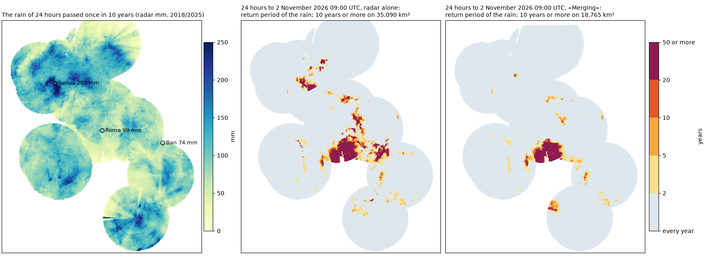

# Rain climatology

::: dpc_radar.climatology

## The measure, in full

`uv run --extra history --with scipy python -m tools.build_climatology
--history <italian-radar-dpc-sri.zarr> --work <folder> --drift --measure
--archive <folder>`.

### The history is not one series

For every year, the highest window of the year of every pixel over the location
of the fit (2018–2025) at that pixel; the median over the pixels with a fit.
1 is "this year read like the map".

| Year | 1 h | 3 h | 6 h | 24 h |
|---|---|---|---|---|
| 2010 | 0.76 | 0.74 | 0.73 | 0.70 |
| 2011 | 0.64 | 0.68 | 0.69 | 0.67 |
| 2012 | 0.71 | 0.73 | 0.74 | 0.77 |
| 2013 | 0.90 | 0.80 | 0.75 | 0.69 |
| 2014 | 1.14 | 1.20 | 1.24 | 1.19 |
| 2015 | 0.75 | 0.77 | 0.78 | 0.85 |
| 2016 | 0.84 | 0.85 | 0.86 | 0.83 |
| 2017 | 0.74 | 0.76 | 0.76 | 0.78 |
| 2018 | 1.22 | 1.15 | 1.11 | 1.13 |
| 2019 | 1.30 | 1.29 | 1.29 | 1.24 |
| 2020 | 1.35 | 1.30 | 1.28 | 1.25 |
| 2021 | 1.16 | 1.11 | 1.08 | 1.06 |
| 2022 | 1.13 | 1.08 | 1.05 | 0.99 |
| 2023 | 1.11 | 1.10 | 1.09 | 1.11 |
| 2024 | 1.23 | 1.21 | 1.20 | 1.18 |
| 2025 | 1.09 | 1.18 | 1.25 | 1.35 |

The step is between 2017 and 2018, in every window. 2014 stands out among the
early years: it is also the year with most corrupted frames (250), and what
`suspect` does not catch is likely still in it.

### Held-out years

The eight years in four blocks of two. For every block, the map is fitted on
the other six years, and the two years left out are counted: the share of
pixel-years whose highest window passes the level. "Same years" is the share
in the six years of the fit.

| Window | Level | Expected | Held-out years | Same years |
|---|---|---|---|---|
| 1 h | 2 years | 0.500 | 0.515 | 0.529 |
| 1 h | 5 years | 0.200 | 0.240 | 0.213 |
| 1 h | 10 years | 0.100 | 0.135 | 0.097 |
| 1 h | 20 years | 0.050 | 0.075 | 0.039 |
| 3 h | 2 years | 0.500 | 0.521 | 0.536 |
| 3 h | 5 years | 0.200 | 0.242 | 0.212 |
| 3 h | 10 years | 0.100 | 0.136 | 0.094 |
| 3 h | 20 years | 0.050 | 0.075 | 0.037 |
| 6 h | 2 years | 0.500 | 0.522 | 0.536 |
| 6 h | 5 years | 0.200 | 0.243 | 0.212 |
| 6 h | 10 years | 0.100 | 0.136 | 0.091 |
| 6 h | 20 years | 0.050 | 0.076 | 0.035 |
| 24 h | 2 years | 0.500 | 0.523 | 0.534 |
| 24 h | 5 years | 0.200 | 0.242 | 0.213 |
| 24 h | 10 years | 0.100 | 0.138 | 0.091 |
| 24 h | 20 years | 0.050 | 0.080 | 0.031 |

A level that says "once in N years" should be passed by 1/N of the pixels in a
year. The levels are passed more often than that out of the years of the fit,
and the gap grows with the return period: six years say little about twenty.
The map in the package is fitted on all eight, so it should do a little better
than this, and there is no ninth year to say how much.

### The hourly frames of 2026

The `SRT1` frames kept from 9 June to 16 November 2026 (3829
hours), summed over the same windows, where the radar is
[reliable](reliability.md) (score from 0.5). They are a different product from
the history (the hourly rain of the DPC, not the sum of the intensity frames)
and they are five months, not a year.

| Window | Pixels | Highest window over the location of the fit | Over the 2-year level | 5-year | 10-year | 20-year | 50-year |
|---|---|---|---|---|---|---|---|
| 1 h | 574276 | 1.17 | 0.501 | 0.234 | 0.121 | 0.061 | 0.025 |
| 3 h | 573194 | 1.22 | 0.541 | 0.279 | 0.157 | 0.087 | 0.037 |
| 6 h | 571469 | 1.19 | 0.531 | 0.279 | 0.164 | 0.096 | 0.045 |
| 24 h | 573834 | 1.22 | 0.550 | 0.307 | 0.203 | 0.135 | 0.073 |

For one hour the frames of 2026 pass the levels about as often as a held-out
year of the history (12 % against 14 % at 10 years). For 24 hours they pass
them more often in five months than a held-out year does in twelve (20 %
against 14 %): use the 24 h return period of a sum of `SRT1` frames with that
in mind.

### One day

The 24 hours to 2 November 2026 09:00 UTC, the widest rain of the archive
against the map (the image at the top).

| | 2 years or more | 10 years or more | 50 years or more |
|---|---|---|---|
| radar alone (24 `SRT1` hours), where the radar is reliable | 69,264 km² | 28,323 km² | 13,302 km² |
| «Merging» (8 `CUM3` frames), same pixels | 30,572 km² | 13,763 km² | 8,221 km² |

Where the radar alone says 10 years or more it has 100 mm on average and the
«Merging» 47. Its highest pixel has 382 mm, and the «Merging» 7 mm in the same
place. Most of the area is over the Tyrrhenian Sea, where there are no gauges
and the «Merging» is the radar with another calibration.
