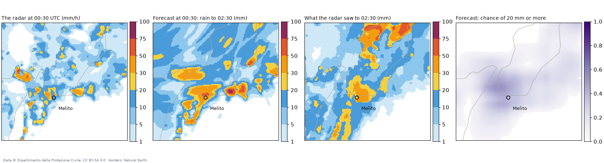

# The rain of the next two hours

The radar shows rain that has already fallen. `nowcast` moves the latest SRI
frame forward along the motion the rain had in the last half hour: a forecast
for the next two hours, every five minutes. `rain_ahead` sums it into
millimetres, `chance` turns it into a probability, `motion` says where the
rain is going and how fast.



```python
from datetime import timedelta
from dpc_radar import chance, motion, nowcast, rain_ahead  # pip install "dpc-radar[nowcast]"

now = await radar.latest("SRI")
before = [await radar.at("SRI", now.time - timedelta(minutes=5 * k)) for k in range(6, 0, -1)]
frames = [f for f in before if f] + [now]  # the last half hour, the oldest first

melito = [(15.78, 37.92)]
motion(frames).at(*melito[0])  # (5.6, 82.9): km/h, and degrees from north: to the east
rain_ahead(frames, minutes=120).sample(melito)  # [44.7] mm forecast by 02:30
chance(frames, mm=20, minutes=120).sample(melito)  # [0.40]

for forecast in nowcast(frames, minutes=60):  # twelve fields of mm/h
    print(forecast.time, forecast.lead, forecast.sample(melito))
```

The numbers are those of 10 October 2026 at 00:30 UTC, the night of the flood
of Melito di Porto Salvo; in the two hours that followed the radar saw
31.3 mm there.

Every function returns a `Forecast`, never a `RainGrid`: it carries the time
it was issued and how far ahead it looks, and it cannot be passed by mistake
where observed rain is expected. Where the rain would come from outside the
frame, or from a place the radar does not see, the forecast is `NaN`: not
known, which is not dry.

**How far to trust it.** The rain is moved, not changed. A storm born after
the last frame is not in the forecast, one that dies is still there, and one
that stays over a mountain while the others pass is moved away with them. So
it is fair on where the rain area will be at 30 to 60 minutes and poor on
where the peaks will be; `chance` says so with a number, and that number can
be trusted more than the map of millimetres. Nothing here replaces the
official DPC alert.

::: dpc_radar.nowcast

## The measure, in full

```bash
uv run --extra history python -m tools.measure_nowcast \
    --history italian-radar-dpc-sri.zarr --cases 120 --seed 2026
```

The tool draws moments at random from the IT-DPC-SRI history of 2021–2025 (a
frame every five minutes), one per day at most, and keeps those with heavy
rain somewhere (300 km² at 10 mm/h or more), the half hour before and the two
hours after complete, and no corrupted frame. On each it runs the nowcast on
the frames of the last half hour and compares it, pixel by pixel over the
whole of Italy, with what the radar saw next. With seed 2026 these are 120
moments between 5 January 2021 and 2 December 2025; the rain moved at 17 km/h
(the median over the cases, from 0 to 70).

"Persistence" is the last frame left where it is: the forecast that knows
nothing of motion, and the one every use of the radar makes without saying
so. CSI is, of the pixels where rain over a threshold was forecast or seen,
the share where it was both (1 is perfect); the bias is pixels forecast over
pixels seen (1 is the right amount of rain).

### The intensity, minute by minute

| mm/h | Minutes ahead | Nowcast: CSI (bias) | Persistence: CSI (bias) |
|---|---|---|---|
| 1 | 30 | 0.47 (1.02) | 0.38 (1.04) |
| 1 | 60 | 0.34 (1.05) | 0.27 (1.08) |
| 1 | 120 | 0.23 (1.06) | 0.19 (1.12) |
| 5 | 30 | 0.25 (1.00) | 0.18 (1.03) |
| 5 | 60 | 0.15 (1.06) | 0.10 (1.10) |
| 5 | 120 | 0.08 (1.01) | 0.06 (1.08) |
| 10 | 30 | 0.17 (0.96) | 0.10 (1.01) |
| 10 | 60 | 0.08 (1.03) | 0.05 (1.10) |
| 10 | 120 | 0.04 (0.99) | 0.03 (1.08) |

The nowcast is better than persistence at every threshold and every lead, and
it is still not good on heavy rain: at one hour, of the pixels where 10 mm/h
were forecast or seen, 8 in 100 had both. A pixel is one kilometre, and a
convective core is a few kilometres wide and lives less than an hour.

### The rain of the next hour

| mm in the hour | Nowcast: CSI (bias) | Persistence: CSI (bias) |
|---|---|---|
| 5 | 0.34 (1.12) | 0.23 (1.22) |
| 10 | 0.25 (1.18) | 0.15 (1.52) |
| 20 | 0.17 (1.32) | 0.09 (2.24) |

Sums are easier than instants. The bias over 1 is the storm that is not
allowed to die: `rain_ahead` forecasts 20 mm on a third more pixels than get
them. Persistence, the last frame multiplied by the hour, does it on more
than twice as many.

### The chance

`chance` is not an ensemble. It is the share of the pixels around a place,
within a distance that grows by 0.2 km for every minute of lead (12 km at one
hour), where `rain_ahead` is over the threshold: "the storm will be here, or
a few kilometres from here". The Brier skill compares it with saying
everywhere the share of pixels that got the rain (0 is no better than that, 1
is perfect); "yes or no" is `rain_ahead` read as a certainty.

| mm | Minutes ahead | Pixels that got it | `chance`: Brier skill | Yes or no: Brier skill |
|---|---|---|---|---|
| 5 | 30 | 0.17 % | +0.33 | −0.01 |
| 5 | 60 | 0.55 % | +0.33 | −0.05 |
| 5 | 120 | 1.58 % | +0.31 | −0.08 |
| 10 | 30 | 0.04 % | +0.20 | −0.26 |
| 10 | 60 | 0.14 % | +0.20 | −0.31 |
| 10 | 120 | 0.45 % | +0.17 | −0.41 |
| 20 | 30 | 0.01 % | +0.18 | −0.37 |
| 20 | 60 | 0.03 % | +0.10 | −0.64 |
| 20 | 120 | 0.09 % | +0.08 | −0.78 |

Read as a certainty, the map of forecast millimetres is worse than knowing
nothing but how often it rains. Read as a chance, it is worth something at
every threshold, less and less as the rain gets heavier.

And the chance means what it says. Of the pixels given a chance for the next
hour, the share where the rain came:

| Chance given | 5 mm | 10 mm | 20 mm |
|---|---|---|---|
| 0–5 % | 0.09 % | 0.03 % | 0.01 % |
| 5–20 % | 7.2 % | 6.3 % | 5.2 % |
| 20–40 % | 20.9 % | 20.1 % | 19.1 % |
| 40–60 % | 40.5 % | 39.0 % | 33.8 % |
| 60–80 % | 60.9 % | 58.0 % | 42.2 % |
| 80–100 % | 78.7 % | 68.9 % | 83.0 % |

Each share should fall inside its row, and nearly all do, towards the low
end: the chance is a little too sure of itself when it is high. The last two
rows for 20 mm stand on 1,980 and 541 pixels out of 98 million, a handful of
storms.

### One night: Melito di Porto Salvo, 10 October 2026

The SRI of that night, from the API, every half hour: what was forecast for
the town (15.78° E, 37.92° N) for the two hours that followed, and what the
radar then saw there. The motion was towards the east all night.

| Issued (UTC) | Motion | Forecast, 2 h | Seen by the radar, 2 h | Chance of 20 mm |
|---|---|---|---|---|
| 23:30 | 6 km/h | 5.0 mm | 38.8 mm | 0.20 |
| 00:00 | 1 km/h | 39.1 mm | 35.8 mm | 0.43 |
| 00:30 | 6 km/h | 44.7 mm | 31.3 mm | 0.40 |
| 01:00 | 11 km/h | 13.4 mm | 29.6 mm | 0.34 |
| 01:30 | 8 km/h | 42.5 mm | 24.4 mm | 0.55 |
| 02:00 | 3 km/h | 8.9 mm | 30.1 mm | 0.37 |
| 02:30 | 5 km/h | 3.7 mm | 37.9 mm | 0.18 |
| 03:00 | 7 km/h | 30.8 mm | 38.2 mm | 0.41 |
| 03:30 | 9 km/h | 21.2 mm | 32.1 mm | 0.45 |
| 04:00 | 6 km/h | 19.7 mm | 21.1 mm | 0.38 |

It rained over 20 mm in every one of those two-hour windows. The millimetres
forecast go from 4 to 45: the storm stood nearly still and was born again and
again over the same place, which is what an extrapolation cannot know. The
chance stayed between 0.2 and 0.55 all night, and it was at its lowest at
23:30, before the first cells, and at 02:30, between two of them. A chance of
0.4 of 20 mm in two hours, on a map where the usual value is under 0.001, is
a warning; it is not a forecast of a flood.

### How the numbers in the code were chosen

On 60 other storms of the same history (another seed), not on the 120 above.

- **The motion over the last half hour**, not the last ten minutes: with a
  shorter baseline the shift is a pixel or two and its error is as large.
- **Blocks of 192 km**: smaller blocks follow single cells, which are born and
  die, and the motion gets worse.
- **A window that fades the edges of each block** (Hann) gave +0.005 of CSI
  on real storms and made a clean synthetic storm 12 % too slow. Left out.
- **0.2 km a minute** for `chance`: the distance that scored best was about
  6 km at 30 minutes, 12 km at 60 and 24–28 km at 120.

### What is not there

- **Growth and decay.** The rain is only moved. This is the first step of
  [pySTEPS](https://pysteps.github.io/), not the whole of it.
- **An ensemble.** `chance` is a neighbourhood, not a set of possible
  futures: it says nothing about two places together (a whole catchment),
  only about each pixel.
- **A learned nowcast.** It needs years of frames and a GPU, and a measure
  like this one to beat first.
- **A check on rare events.** The measure is on moments of heavy rain drawn
  at random, not on the [catalogue of rare rain](catalogue.md): the 2026
  archive it comes from has hourly frames, and a nowcast needs one every five
  minutes. Only the night of Melito was fetched from the API.
- **The gauges.** The forecast is in radar millimetres, of the SRI: what the
  radar is far from, [place by place](bias.md), it is far from too.
