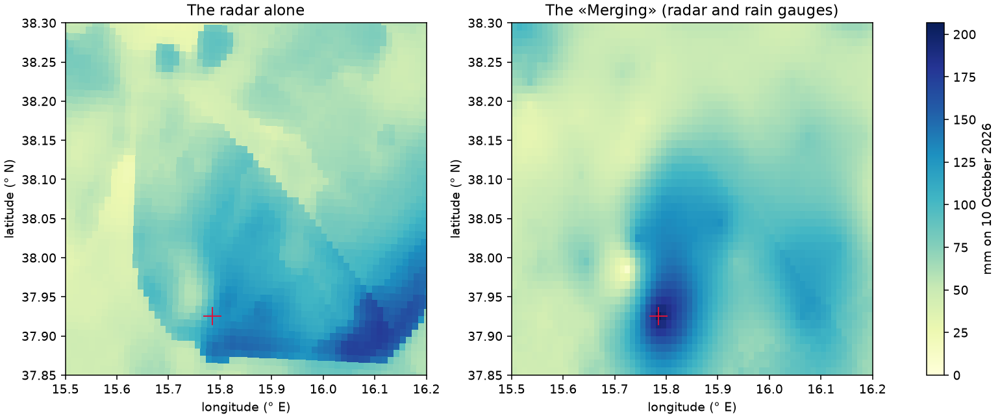
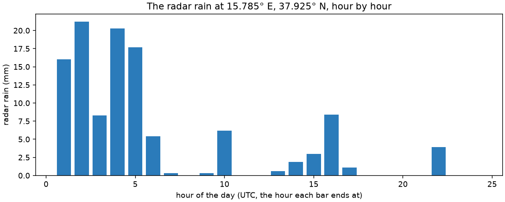

# Event reports

`dpc-radar report` writes the report of a day of rain over a box: the
figures as data, a text that only quotes them, and two images.

```bash
pip install "dpc-radar[report]"
dpc-radar report --bbox 15.5,37.85,16.2,38.3 --day 2026-10-10 --out melito
# melito/facts.json  melito/report.md  melito/map.png  melito/hourly.png
```

The frames come from the API (the last five months: 33 requests) or, with
`--archive folder`, from an archive kept with
[`dpc_radar.archive`](archive.md). `--no-bulletin` skips the official alert,
`--no-images` the images.

## One day: Melito di Porto Salvo, 10 October 2026

The command above, on the archive Limen keeps. These are the images it
wrote, and part of its text.



> **The «Merging»** (radar corrected with the rain gauges: the sum of 8 CUM3
> frames out of 8). The maximum is **206.7 mm**, at 15.785° E, 37.925° N.
> Over the box the mean is 73.9 mm and the median 65.2 mm. Of the box,
> 3094.8 km² got 20 mm or more, 2434.6 km² got 50 mm or more, 567.6 km² got
> 100 mm or more, 1.0 km² got 200 mm or more.
>
> **The radar alone** (no rain gauges: the sum of 24 SRT1 frames out of 24).
> The maximum is **176.4 mm**, at 16.1096° E, 37.9053° N. […]
>
> At 15.785° E, 37.925° N, read as the median of the nine pixels around it:
> the «Merging» gives **190.8 mm** in the day; the radar alone gives
> **115.1 mm**.
>
> | Hours | Radar rain | Ended at | Return period |
> |---|---|---|---|
> | 1 | 21.2 mm | 02:00 | about 2 years (between 2 and 5) |
> | 3 | 49.8 mm | 04:00 | about 7 years (between 3 and 15) |
> | 6 | 88.9 mm | 06:00 | about 31 years (between 10 and 50) |
> | 24 | 114.6 mm | 00:00 | about 42 years (between 14 and 50) |
>
> How far to trust the radar there: its reliability is 0.9 on a scale from
> zero to one, so a radar reading can be taken at face value. The nearest
> radar is Catania Fontanarossa, 82.4 km away.
>
> The bulletin issued on 9 October 2026 at 16:15 (Italian time) put the
> wettest place, in the zone «Versante Jonico Meridionale», at level
> **orange** for 10 October 2026 (hydrogeological risk: orange; hydraulic:
> orange; thunderstorms: orange).



The whole of its figures is in [`facts.json`](../data/melito-2026-10-10.json).
Over the whole box the radar alone and the «Merging» agree (the ratio of the
two means is 1.01); at the place where it rained most the radar alone read
115 mm where the «Merging» has 191.

## The text cannot invent a number

The text is written from a template, with no language model. Before anything
is saved it is read back: every number in it must be one of the figures of
`facts.json`, to the decimals it is written with ("191.8" matches 191.84,
"190" does not). Product names (`CUM3`) are not numbers, and dates and times
are matched against the times in the facts.

The same check is there for a text written by someone else, a language model
included:

```bash
dpc-radar report --bbox … --day … --out melito --text mine.md   # saved only if it passes
dpc-radar check melito/report.md melito/facts.json
# numbers that are not in the facts: 250
```

```python
from dpc_radar.report import check_text

check_text("It rained 250 mm.", report.facts)  # ["250"]: the numbers that are not there
```

**What the check does not do.** It knows that a number exists in the facts,
not that it is said of the right thing: "the radar alone read 206.7 mm"
passes, because 206.7 is there, as the maximum of the «Merging». It catches
an invented figure, not a swapped one. Small whole numbers nearly always
pass (the facts hold a 2, a 3 and a 10 somewhere), and it does not read
words ("twice as much", "a record"). A text from a model still needs a reader.

## What is in the facts

- **`event`**: the day (a UTC day), the box, the times.
- **`frames`**: for the radar alone and the «Merging», the frames expected,
  used, missing and rejected, and how many pixel readings were masked. With
  a frame missing or rejected the total is marked not `complete`, and the
  text says "at least".
- **`radar`**, **`merging`**: over the box, the maximum and its place, mean,
  median, 95th percentile, km² over 20, 50, 100 and 200 mm.
- **`hourly`**: the radar alone for each hour: maximum, mean, km² at 10 mm
  or more.
- **`peak`**: the wettest place (the maximum of the «Merging», or of the
  radar when there is none), read as the median of 3×3 pixels: both totals,
  the radar rain of each hour, the wettest 1, 3, 6 and 24 hours and their
  [return period](climatology.md), the [reliability](reliability.md) of the
  radar there.
- **`bulletins`**: the level the [official bulletin](bulletins.md) gave to
  that place for that day, from the bulletin of the day and of the day
  before.

Each `SRT1` frame is checked against the hour before it, and each `CUM3`
against the radar of its three hours (a rain gauge gone wrong), with
[`quality`](quality.md). The two totals are on two grids, each over the
rectangle of its own pixels that holds the box, so their areas differ a
little.

**What is not there.** The report is one UTC day: a storm across midnight
is two reports. There are no rain gauges of their own (the DPC does not
publish them), no rivers, no damage. The return periods are in radar
millimetres, from eight years. And it is a reading of radar data: the
official account of an event is that of the Civil Protection.

::: dpc_radar.report
