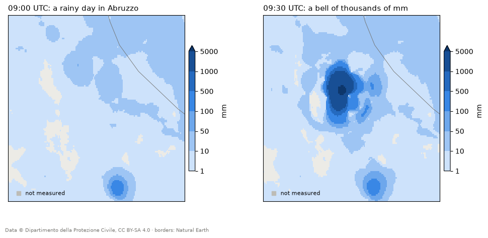
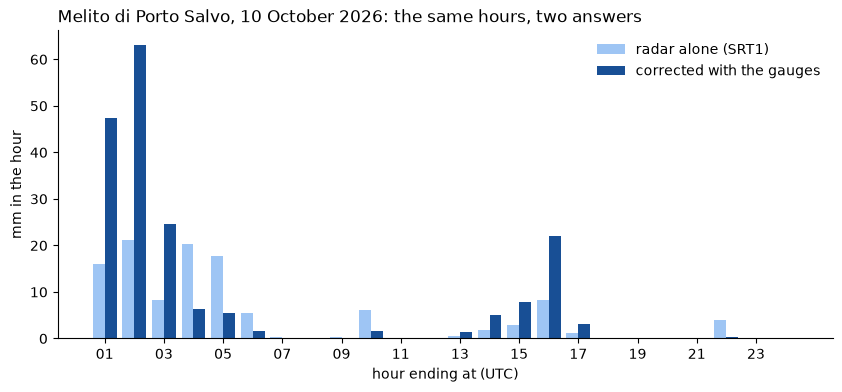
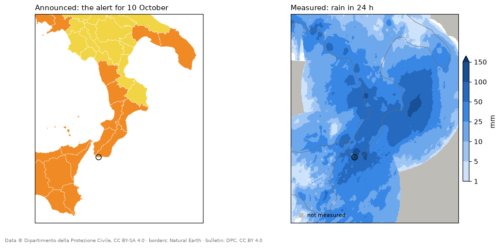
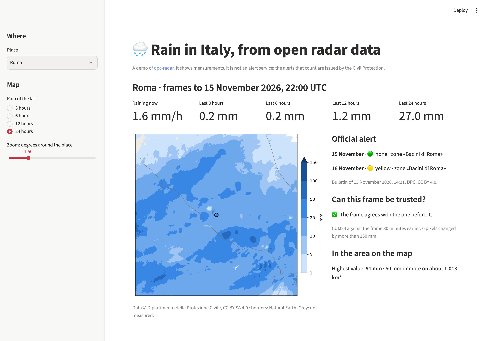
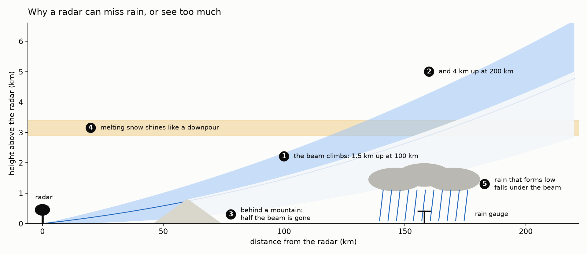

# Notebooks and example apps

The fastest way to understand the library is to watch it work on a real
storm.

## Notebooks

Each notebook is saved with its results: read it on GitHub, or open it in
Colab and run it with nothing to install.

| | Notebook | What it shows | Run it |
|---|---|---|---|
| 1 | [Your first rain map of Italy](https://github.com/agent-engineering-studio/dpc-radar/blob/main/notebooks/01_first_rain_map.ipynb) | The latest frame, the rain on your city, and why «no data» is not «no rain». | [Colab](https://colab.research.google.com/github/agent-engineering-studio/dpc-radar/blob/main/notebooks/01_first_rain_map.ipynb) |
| 2 | [Anatomy of a storm](https://github.com/agent-engineering-studio/dpc-radar/blob/main/notebooks/02_anatomy_of_a_storm.ipynb) | The flood of Melito di Porto Salvo (10 October 2026) hour by hour, and what the radar alone lost. | [Colab](https://colab.research.google.com/github/agent-engineering-studio/dpc-radar/blob/main/notebooks/02_anatomy_of_a_storm.ipynb) |
| 3 | [Trust, but verify](https://github.com/agent-engineering-studio/dpc-radar/blob/main/notebooks/03_trust_but_verify.ipynb) | A published frame with 7,348 mm of false rain, and the check that rejects it. | [Colab](https://colab.research.google.com/github/agent-engineering-studio/dpc-radar/blob/main/notebooks/03_trust_but_verify.ipynb) |
| 4 | [Hourly rain from your own archive](https://github.com/agent-engineering-studio/dpc-radar/blob/main/notebooks/04_hourly_rain_archive.ipynb) | Save the frames before they are gone, then read rain per hour corrected with the gauges. | [Colab](https://colab.research.google.com/github/agent-engineering-studio/dpc-radar/blob/main/notebooks/04_hourly_rain_archive.ipynb) |
| 5 | [The official alert, next to the radar](https://github.com/agent-engineering-studio/dpc-radar/blob/main/notebooks/05_alert_vs_radar.ipynb) | What the bulletin announced and what fell, zone by zone. | [Colab](https://colab.research.google.com/github/agent-engineering-studio/dpc-radar/blob/main/notebooks/05_alert_vs_radar.ipynb) |

*Notebook 3: the frame published on 11 October 2026 at 09:30 UTC, the one
before it, and the pixels that jumped. The check rejects it.*

*Notebook 4: the same hours at Melito di Porto Salvo. Radar alone never
reaches 30 mm in an hour; corrected with the gauges, two hours do.*

*Notebook 5: the alert issued on 9 October for the day after, and the rain
that fell.*

Notebooks 2, 4 and 5 read frames of 10 October 2026, which the DPC keeps
until about March 2027. After that, change the date at the top to a recent
storm.

## Example apps

Four programs in
[`examples/`](https://github.com/agent-engineering-studio/dpc-radar/tree/main/examples), each one file.

| Program | What it does | Run it |
|---|---|---|
| [`rain_at.py`](https://github.com/agent-engineering-studio/dpc-radar/blob/main/examples/rain_at.py) | the rain at a place: now, last 3–24 hours, official alert | `uv run python examples/rain_at.py 12.50 41.90 --name Roma` |
| [`storm_watch.py`](https://github.com/agent-engineering-studio/dpc-radar/blob/main/examples/storm_watch.py) | tells you when a violent shower enters an area | `uv run python examples/storm_watch.py --rate 30` |
| [`nightly_archive.py`](https://github.com/agent-engineering-studio/dpc-radar/blob/main/examples/nightly_archive.py) | keeps your archive up to date; made for cron | `uv run python examples/nightly_archive.py ~/radar-archive` |
| [`app.py`](https://github.com/agent-engineering-studio/dpc-radar/blob/main/examples/app.py) | a rain dashboard for any town | `uv run --group examples streamlit run examples/app.py` |

## The theory, in one picture

The radar beam climbs with distance, mountains hide part of it, melting snow
echoes like a downpour, and rain that forms low falls under the beam. The
[home page](index.md#how-a-radar-measures-rain-in-plain-words) explains each
point in plain words, and why the «Merging» with the rain gauges is the
number to trust for totals.
