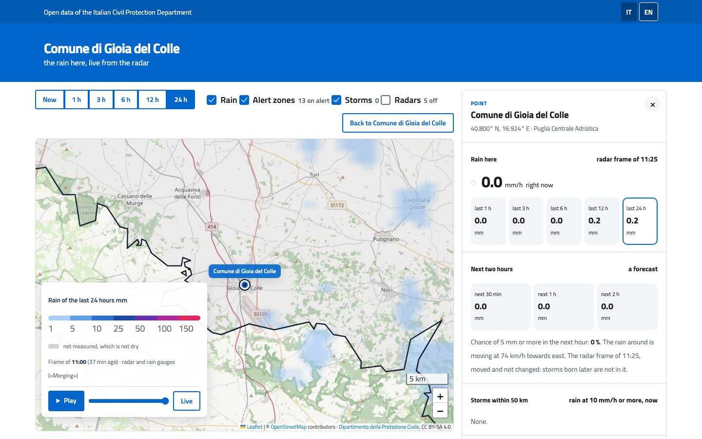

# Riuso nella Pubblica Amministrazione

dpc-radar legge dati aperti di un'amministrazione, il Dipartimento della
Protezione Civile, e li rende usabili da chiunque. Questa pagina è per un ente
che vuole usarlo: che cosa trova pronto, che cosa resta a lui, e come il
progetto entra nel Catalogo del software di Developers Italia.

## La mappa sul sito del Comune

La demo è una pagina fatta per stare sul sito di un ente. Usa
[Bootstrap Italia](https://italia.github.io/bootstrap-italia/), il kit di
interfaccia della PA, servito dalla pagina stessa senza CDN, ed è in italiano
e in inglese.



Si apre sulle coordinate dell'ente, con il nome dell'ente in testata, un
segnaposto sul punto e la scheda di quel punto già aperta:

- la pioggia di adesso e delle ultime 1, 3, 6, 12 e 24 ore;
- quanto è rara quella pioggia in quel posto;
- la previsione automatica delle prossime due ore, e la probabilità di pioggia;
- i temporali entro 50 km, e dove vanno;
- l'allerta ufficiale del bollettino di criticità per la zona, oggi e domani;
- quanto ci si può fidare del radar in quel punto, e quali radar sono accesi.

Senza coordinate la mappa si apre su Gioia del Colle, in Puglia.

```bash
cp .env.example .env
# nel file .env:
#   DPC_RADAR_LAT=40.7997
#   DPC_RADAR_LON=16.9236
#   DPC_RADAR_PLACE="Comune di Gioia del Colle"
docker compose up
```

| Variabile | Che cosa fa | Senza |
|---|---|---|
| `DPC_RADAR_LAT`, `DPC_RADAR_LON` | le coordinate su cui la mappa si apre, in gradi decimali | Gioia del Colle |
| `DPC_RADAR_ZOOM` | lo zoom di partenza, da 5 a 13 | 11 con le coordinate, 10 senza |
| `DPC_RADAR_PLACE` | il nome mostrato in testata e sul segnaposto | «dpc-radar» |
| `DPC_RADAR_LAYER` | che cosa mostra la mappa all'apertura: `now`, `1`, `3`, `6`, `12` o `24` | `now` |
| `DPC_RADAR_TILES` | l'indirizzo delle tessere della mappa di sfondo | OpenStreetMap |
| `DPC_RADAR_TILES_CREDIT` | l'attribuzione di quelle tessere | OpenStreetMap |

Le stesse cose si possono dare nell'indirizzo, per incorporare la
pagina in un'altra:

```html
<iframe
  src="https://pioggia.example.it/?lat=40.7997&lon=16.9236&place=Comune%20di%20Gioia%20del%20Colle"
  title="La pioggia a Gioia del Colle, dal radar"
  width="100%" height="900"></iframe>
```

Coordinate fuori dall'Italia, o scritte male, sono ignorate: la mappa si apre
su Gioia del Colle.

## Che cosa resta all'ente

Il progetto dà il software. Queste cose sono di chi lo pubblica.

- **Non è un'allerta.** La pagina lo dice in fondo e in ogni scheda, e rimanda
  al bollettino di criticità. Non va presentata come servizio di allertamento.
- **Attribuzione dei dati.** I dati radar sono del Dipartimento della
  Protezione Civile, CC BY-SA 4.0: la pagina lo scrive sulla mappa e in fondo,
  e va lasciato.
- **La mappa di sfondo.** Le tessere vengono da OpenStreetMap, che così vede
  l'indirizzo IP di chi visita la pagina. Un ente che non vuole chiamate a
  terzi mette le proprie tessere in `DPC_RADAR_TILES`. È l'unica chiamata a
  terzi del browser: caratteri e stili sono serviti dalla pagina.
- **Dati personali.** Il software non ne raccoglie: niente account, niente
  cookie, niente su disco. La lingua scelta resta nel browser di chi visita.
- **Accessibilità.** La pagina ha il collegamento per saltare al contenuto, i
  comandi con nome e stato, e la scheda del punto come alternativa testuale
  alla mappa. Non ha avuto una verifica WCAG 2.1 AA completa: la
  dichiarazione di accessibilità è dell'ente, dopo la sua verifica.
- **Ospitalità.** HTTPS, un limite alle richieste davanti all'API e
  l'aggiornamento dell'immagine sono di chi ospita (vedi `SECURITY.md`).

## Intelligenza artificiale

Niente di ciò che la pagina e la libreria mostrano è scritto da un modello
linguistico: i numeri sono calcolati dai dati radar con codice aperto, e la
pagina lo dice in fondo. La previsione delle prossime due ore è l'ultima
immagine radar spostata lungo il suo movimento.

L'unico punto in cui il progetto chiama un modello, Claude di Anthropic, è un
esperimento del benchmark, che si lancia a mano e con una chiave
(`benchmarks/vision.py`). La tabella con i principi delle *Linee Guida per
l'adozione di IA nella Pubblica Amministrazione* di AgID (versione 1.0, 9
novembre 2026) è nella [pagina iniziale](index.md#for-a-public-administration).
La classe di rischio, la valutazione d'impatto e l'informativa agli utenti
riguardano l'uso che l'ente ne fa, e sono sue.

## Il Catalogo di Developers Italia

**Oggi: software open source di terze parti.** Il codice non è di una PA.
Entra nel Catalogo con il file [`publiccode.yml`](https://github.com/agent-engineering-studio/dpc-radar/blob/main/publiccode.yml)
nel repository, con `codiceIPA` vuoto, e una segnalazione sul repository
[`italia/catalogo-software`](https://github.com/italia/catalogo-software) con
il modello «Aggiungi un software al Catalogo».

**Domani: software a riuso.** Se un ente lo adotta e ne diventa titolare (art.
69 del CAD), lo dichiara con l'[onboarding](https://onboarding.developers.italia.it/)
di Developers Italia; `codiceIPA` prende il codice dell'ente, e gli enti che
lo usano vanno in `usedBy`.

- [x] Repository pubblico, licenza Apache-2.0
- [x] README, documentazione, istruzioni di installazione con Docker
- [x] `CONTRIBUTING.md`, `CHANGELOG.md`, `SECURITY.md`
- [x] `publiccode.yml` valido per il validatore ufficiale, controllato a ogni modifica dalla CI
- [x] Interfaccia con Bootstrap Italia
- [ ] `publiccode.yml` sul ramo principale
- [ ] Segnalazione su `italia/catalogo-software`
- [ ] Verifica di accessibilità WCAG 2.1 AA della pagina

La licenza è Apache-2.0, non EUPL-1.2: il Catalogo accetta le licenze open
source approvate, e la EUPL è quella consigliata per il software di cui una PA
è titolare.

## Fonti

- [Developers Italia: pubblicare software per la PA](https://developers.italia.it/it/guide/pubblicare-software-per-la-pa)
- [Catalogo del software](https://catalogo-software.developers.italia.it/)
- [Lo standard publiccode.yml](https://yml.publiccode.tools/)
- [AgID: linee guida su acquisizione e riuso di software per la PA](https://www.agid.gov.it/it/design-servizi/riuso-open-source/linee-guida-acquisizione-riuso-software-pa)
- [Bootstrap Italia](https://italia.github.io/bootstrap-italia/)
