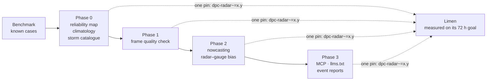

# Roadmap and AI

Where dpc-radar goes next, and how AI and machine learning can make the radar
data better. Nothing here is a promise. Every item has an issue: comment there
before you start. The whole plan is tracked in
[#10](https://github.com/agent-engineering-studio/dpc-radar/issues/10).

dpc-radar is being extracted from
[Limen](https://github.com/agent-engineering-studio/limen), an open
early-warning system for landslides, floods and wildfires in Italy. Limen
uses the DPC radar three ways: as a **trigger** (heavy rain on the radar
starts a run at once), as **rain already fallen** (the «Merging» totals feed
the flood score and the wildfire drought codes), and as **history** (radar
rain from 2010 to 2025 replays past landslides). Every improvement below lands
in this library first, and Limen gets it by updating one pin.

## The goal we measure against

Limen has one goal that decides whether it is useful
([limen#345](https://github.com/agent-engineering-studio/limen/issues/345)):
**anticipate within 72 hours 90 % of the landslides, floods and wildfires
reported in the news, with at most 10 % of municipality-days on alert.** The
two numbers always go together: without the second, it is easy to catch
everything by putting everything on alert.

On 29 October 2026 Limen anticipated **0 of 4** landslides and **0 of 4**
floods. The radar is part of the reason, and of the fix.

## What limits Limen today

| Problem | Where it shows | What the radar has to do with it |
|---|---|---|
| **Alerts were the background, not a forecast** | the four landslides were ≥ Moderate for 64–80 h, but so were ordinary days ([limen#345](https://github.com/agent-engineering-studio/limen/issues/345)) | one national rain threshold cannot work: 50 mm is common in Liguria, exceptional in Apulia |
| **Too few events to measure** | "eight events are an anecdote, not a statistic" | the radar sees every storm, including the ones nobody has verified yet |
| **Corrupted frames** | pixels moving 900–20,584 mm between frames ([limen#235](https://github.com/agent-engineering-studio/limen/issues/235)) | today a fixed rule, `max_step_mm: 150`, throws them away |
| **A blind radar reads as dry** | the cloudburst on Lipari, 10/10/2026, which the radar did not see | Limen cannot tell "no rain" from "no radar here" |
| **The radar arrives late** | Melito, 10/10/2026: forecast 20 mm, radar 152 mm | the radar only shows rain that has already fallen |
| **A biased history** | the radar-only archive read 10–80 % of the gauges in Apulia in 2016 | landslide backtests ([limen#243](https://github.com/agent-engineering-studio/limen/issues/243)) rest on it |

## How we introduce AI

1. **Benchmark first, then models.** A fixed set of cases where we already
   know the answer. Every method passes it before it reaches Limen.
2. **Machine learning on the data, language models only on language.**
   Statistics, gradient boosting and optical flow work on the frames. A
   language model may read news, choose what to compute and explain the
   result in words.
3. **Measured on Limen's goal.** Each item says which number of limen#345
   it should move, and how we check it.

!!! warning "Ground rule for every AI feature"
    Rain values come from DPC frames, read by code that is tested. A
    language model never produces a millimetre, a time or a place itself.
    Every answer names the product and the frame time it came from. Nothing
    this library produces is an official warning: the official one is the
    DPC criticality bulletin, and every AI output links to it.

---

## Phase 0 · now, without touching Limen's code

This phase works on notebooks, data and the benchmark. Limen's radar code
(`grid`, `client`) can move here at any time: Limen is not in operation yet,
so there is no date to wait for.

### Benchmark of known cases · [#2](https://github.com/agent-engineering-studio/dpc-radar/issues/2) · ✅ first version

Fourteen real cases in [`benchmarks/`](benchmark.md): the Melito storm and the
Lipari miss of 10 October 2026, the corrupted :30 CUM24 series (found on
30/09–02/10, 08–11/10 and 21/10–03/11), the clean frame right after a corrupted
one, two calm days, a stuck rain gauge (1,152 mm in CUM24 on a dry night), a
band of rain at sea that looked like clutter, and three hours of radar only
(`SRT1`). Limen's rule today passes **14 of 30** checks: it has no frame-level
decision, lets the edges of the corrupted bell through (88 mm where the truth
is 9), throws away good pixels after a corrupted frame, and cannot see steady
artefacts or blind spots. The library passes all 30 since the frame quality
check (#6), which removes the stuck gauge. No case is *suspect* any more: the two that
were have been settled on the hourly radar frames (one was not rain, one was).
Still missing: a check against the rain gauges themselves, which the DPC does
not publish.

### Radar reliability map · [#3](https://github.com/agent-engineering-studio/dpc-radar/issues/3) · ✅ first version

[`dpc_radar.reliability(lon, lat)`](api/reliability.md) gives a score between
0 and 1 and its parts, from a map shipped with the package (720 kB, 1 km):

- **visibility**: the height above the ground of the lowest beam that reaches
  the point without being cut by a mountain, from the 24 radar sites and an
  open terrain model;
- **coverage**: how often the mosaic has data there. From June to November
  2026 the radars of Calabria and Apulia were on 36–61 % of the time, and the
  west of Sicily was never covered;
- **agreement**: the radar alone (SRT1) against the «Merging» (CUM3) over the
  same months: around Palermo the radar read 11 % of the gauge-corrected rain.

**Check:** Lipari scores 0.42 (beam at 3,500 m), Melito 0.90; the benchmark
case passes, with a second check that a map calling everything unreliable
would fail.

**What is not there.** The density of rain gauges: the DPC does not publish
the gauges that enter the «Merging». The positions of seven radars come from
the DPC's table; the others were found by fitting their range circles on the
mosaic's no-data mask, and four that are always hidden under the others come
from the literature. Coverage and agreement describe five months, not a
climate. Limen does not
use the map yet.

### Rain climatology · [#4](https://github.com/agent-engineering-studio/dpc-radar/issues/4) · ✅ first version: eight years, in radar millimetres

[`dpc_radar.rarity(window, lon, lat, mm)`](api/climatology.md) answers "this
rain is a 1-in-N-years event here" for 1, 3, 6 and 24 hours: a percentile and
a return period with its 90 % interval. `return_level` gives the rain of a
return period, `return_period(frame)` the return period of every pixel. The
map ships with the package (1.6 MB, cells of 5 km): a GEV of the highest
window of the year, the location from the cell, the spread from the 55 km
around it, one shape for Italy.

What the history says first: **it is not one series**. Until 2017 the mosaic
read about two thirds of what it reads since 2018 (the highest hour of the
year over today's map: 0.64–0.90 before, 1.09–1.35 after). A map on all
sixteen years puts 61 % of the pixels over their 2-year level in five months
of 2026. So the map stands on 2018–2025, and fewer than one frame in a
thousand, corrupted, is left out (`history.suspect`).

**Check:** fitted on six years and asked about the other two. The 2-year level
is passed by 52 % of the pixels in a year (it should be 50), the 5-year by
24 % (20), the 10-year by 14 % (10), the 20-year by 8 % (5): "10 years" came
about every 7, "20 years" every 13. On the hourly frames of 2026 the 1 h
levels behave the same; the 24 h levels are passed more. The
[tables](api/climatology.md#the-measure-in-full) are in the reference.

**What was tried and dropped.** A fit pixel by pixel, and one with the shape
of each cell: on held-out years the 20-year level was passed by 9–10 % of the
pixels. A shape by area (55 km, 205 km): no better than one for Italy, and a
blotchy map.

**What is not there.**

- **More years.** Eight years cannot say what a 50-year rain is; the map
  stops there and its interval is wide (at 50 years, from 0.8 to 1.5 times
  the level). The years before 2018 could be used only after bringing them to
  today's scale, and nothing here says how.
- **Rain-gauge millimetres.** The levels are those of the radar alone, which
  reads more than the gauges over most of the land (#8). They are not the
  official rainfall curves, and on a radar-only frame the return period brings
  the faults of the frame: on 2 November 2026 the radar alone was over the
  10-year level on twice the area of the «Merging».
- **Limen.** Nothing here measures limen#345: whether judging rain against
  the place gives fewer municipality-days on alert without losing events is
  to be measured in Limen, on held-out seasons. The 2018 step also touches
  its backtests on the history
  ([limen#243](https://github.com/agent-engineering-studio/limen/issues/243)).

### Storm catalogue · [#5](https://github.com/agent-engineering-studio/dpc-radar/issues/5) · effort M

Group SRI cells into storm objects and track them from frame to frame (area,
peak, duration, path). The most extreme storms over inhabited places become
**candidate events**. **For Limen:** the radar says where to look; Limen's
fact-check, which already reads the news with a language model, confirms or
rejects. More verified events, and the storms without damage that a
calibration also needs. **Check:** new verified events per month of archive.

---

## Phase 1 · now that `grid` and `client` are here

### Frame quality check · [#6](https://github.com/agent-engineering-studio/dpc-radar/issues/6) · ✅ first version, rules not a model

[`RainGrid.quality`](api/quality.md) gives a score per frame, a mask per pixel
and the reason for each masked pixel. Four rules, each with a threshold
measured on the frames kept from June to November 2026:

- **jump**: where two frames 30 minutes apart differ by more than half an hour
  of rain, the one that jumps up is rejected whole (`jump-sign`). On 96 pairs
  of whole frames it rejects the 44 corrupted :30 frames and no :00 frame;
- **beyond the record**: more than the most rain ever measured in Italy over
  the window. It needs no frame before;
- **outlier**: a pixel far above the 5×5 around it;
- **gauge only**: «Merging» rain that the radar alone did not see, where the
  radar sees well. It removes the stuck gauge, and on 1,270 three-hour frames
  it finds the same fault in 154, mostly at seven places that come back.

**Check:** the benchmark, 30 of 30 (Limen today: 14); the calm days lose 0.02 %
of their pixels, and those are two more faulty gauges.

**What is not there.** A trained model: fourteen labelled cases are too few,
and the rules are the features it would use. Symmetry around a radar site and
rain over the sea against the land nearby: the one case we had for them turned
out to be rain. A check against the gauges themselves, which the DPC does not
publish: that a gauge is faulty is the radar's word, confirmed by hand once.
A faulty gauge where the radar is blind is kept. The `agreement` part of the
reliability map was built before this check and still counts those gauges as
rain the radar missed. Limen does not use `quality` yet. **For Limen:** fewer
false triggers and one rule for flood, wildfire and the trigger.

### Foundations: the code that comes from Limen

| Module | What it does | Status |
|---|---|---|
| `products` | the six products, the API requests and answers, `is_expired` | ✅ done |
| `grid` | `RainGrid`: read a frame, sample a point with the **3×3 median**, peak, crop, `check` against the frame before (`jump-sign`) and `quality` | ✅ done |
| `client` | `RadarClient.latest(product)`, `.at(product, time)` → a grid or `ABSENT`; injectable `httpx` client, retries, `send=` hook | ✅ done |
| `archive` | `archive()` and `MergingArchive`: save the «Merging» before the DPC deletes it; hourly rain, SRT1 rescaled to CUM3 | ✅ done |
| `history` | `SriHistory`: the IT-DPC-SRI archive (2010–2025) with no zarr or xarray | ✅ done, extra `[history]` |
| `bulletins` | the daily DPC criticality bulletin as data: levels per zone, municipalities, zone at a point | ✅ done, extra `[bulletins]` |

---

## Phase 2 · more lead time, a better history

### Nowcasting 0–2 hours · [#7](https://github.com/agent-engineering-studio/dpc-radar/issues/7) · effort M

The SRI field moved forward along its own motion (optical flow, the method of
[pySTEPS](https://pysteps.github.io/)), then an ensemble for probabilities.
Always labelled as a **forecast**, never mixed with observed rain. A
deep-learning nowcast stays a research notebook. **For Limen:** the trigger
fires on rain that is coming, and the first two hours of the flood window use
it instead of a ~9 km model that does not see thunderstorms. **Check:** CSI at
30, 60, 120 minutes on the storm catalogue, then limen#345.

### Radar–gauge bias model · [#8](https://github.com/agent-engineering-studio/dpc-radar/issues/8) · ✅ first version: a map, not a model, and not for the history

[`dpc_radar.correct(frame)`](api/bias.md) multiplies a radar-only frame by a
factor measured place by place: the rain of the «Merging» (CUM3) over the rain
of the radar alone (three SRT1 hours) from June to November 2026, over 9 km,
on land. The map ships with the package (110 kB).

What the archive says first: the radar alone read **20 % more** rain than the
«Merging» (33 % more on land) and passed 30 mm in three hours 1.70 times as
often. Around Milan, Genoa and Rome it read 1.6–1.7 times the «Merging»;
around Palermo less than half.

**Check:** every month corrected with the map of the other months, against
CUM3. Mean error from 1.91 to 1.55 mm; total from 1.20 to 1.00; 30 mm passed
0.89 times as often as the «Merging» instead of 1.70. One factor for the whole
of Italy leaves the error where it was (1.94 mm): the bias is local. The
[full table](api/bias.md#the-measure-in-full) is by region, intensity and month.

**What was tried and dropped.** The hour of the day: the ratio stays within
1.18–1.23. The season: it moves (1.11–1.33 by month), but five months are not
a season to learn from. A model on place, beam height, hour and month
(gradient boosting): about the same mean error, but it passed 50 mm 0.40 times
as often as the «Merging» and almost never 100 mm.

**What is not there.**

- **The corrected history.** The factor describes 2026. In 2016 the radar-only
  history read *less* than the gauges in Apulia, in 2026 the radar reads
  *more* than the «Merging» almost everywhere: the bias changed, and there is
  no «Merging» of 2010–2025 to test a correction on. `SriHistory` is left as
  it is. Closing this needs rain gauges of those years (the regional networks),
  not more radar.
- **Heavy rain.** Where the «Merging» has 30 mm or more, the corrected radar
  reads 0.75 of it (the radar alone 0.91); in July and August it passes 30 mm
  half to two thirds as often. For the peak of a storm the radar alone, or the
  next «Merging», is better.
- **One hour and five minutes.** The factor was measured on three hours; on
  SRT1 and SRI it is an assumption.
- **Sicily**, where it helps little, and wherever the radar is blind.
- **An independent truth.** The «Merging» contains the radar, and the DPC does
  not publish the gauges.

Found on the way: rain gauges that report 1–6 mm every three hours under a dry
radar for weeks (near Foggia, in 504 of 573 wet windows). They are too small
for the `gauge_only` rule of `quality` (30 mm); the map leaves 2,660 km²
around such gauges without a factor. Limen does not use `correct` yet.

---

## Phase 3 · AI for people and agents

### MCP server, `llms.txt`, event reports · [#9](https://github.com/agent-engineering-studio/dpc-radar/issues/9) · effort M

- **MCP server** `dpc-radar mcp`, extra `[mcp]`: `latest`, `rain_at(lon, lat, hours)`,
  `area_summary(bbox, hours)`, `storm_now(bbox)`, `rarity(...)`,
  `official_alert(region)`. Someone can ask "how much has it rained on
  Messina today?" and get an answer computed from the frame, with its time.
- **`llms.txt`, `llms-full.txt` and an agent skill**, as in
  [egms-client](https://agentengineering.it/egms-client/): the traps a model
  gets wrong when it writes radar code from memory.
- **Event reports** `dpc-radar report --bbox … --day …`: maps, the hourly
  chart, radar against «Merging», the official bulletin, and a short text
  written from a JSON of computed figures. Every number in the text is checked
  against the JSON before the report is saved.

**For Limen:** the same facts for its assistant and briefings, which run on a
local model (faithfulness eval: 16 of 16 briefings with no invented number),
as structured data instead of prose
([limen#371](https://github.com/agent-engineering-studio/limen/issues/371)).

### In the development loop

| Idea | What | Effort |
|---|---|---|
| **Weekly live test** | a scheduled job that calls the real API and fails when an answer changes shape, like the `origin` header that stopped being required in 2026 | S |
| **Issue on failure** | when the live test fails, an agent opens an issue with the old and new answer side by side | S |
| **Parity test with Limen** | the same frame sampled by Limen and by the library gives the same values on the cells of Melito and the Reggio area | S |

---

## What Limen gains, in one table

| Limen today | With dpc-radar | Issue | Number of limen#345 it should move |
|---|---|---|---|
| one national rain threshold | rain judged against the climate of each cell: `rarity` (done); its use in Limen (open) | #4 | fewer municipality-days on alert, to be measured |
| 8 verified events | candidate events from the storm catalogue, checked in the news | #5 | a denominator worth measuring |
| radar zero read as dry where the radar is blind | a reliability map | #3 | fewer missed events |
| a fixed 150 mm rule for bad frames | a score per frame and pixel, with the reason | #6 | fewer false alarms |
| a trigger on rain already fallen | a trigger on rain that is coming (0–2 h) | #7 | more events anticipated |
| a radar-only history that under-estimates | a factor for the radar alone of 2026 (done); the history needs gauges of those years (open) | #8 | radar-only rain closer to the «Merging»; backtests still on biased rain |
| facts written into prose | facts as data, for agents and reports | #9 | — |
