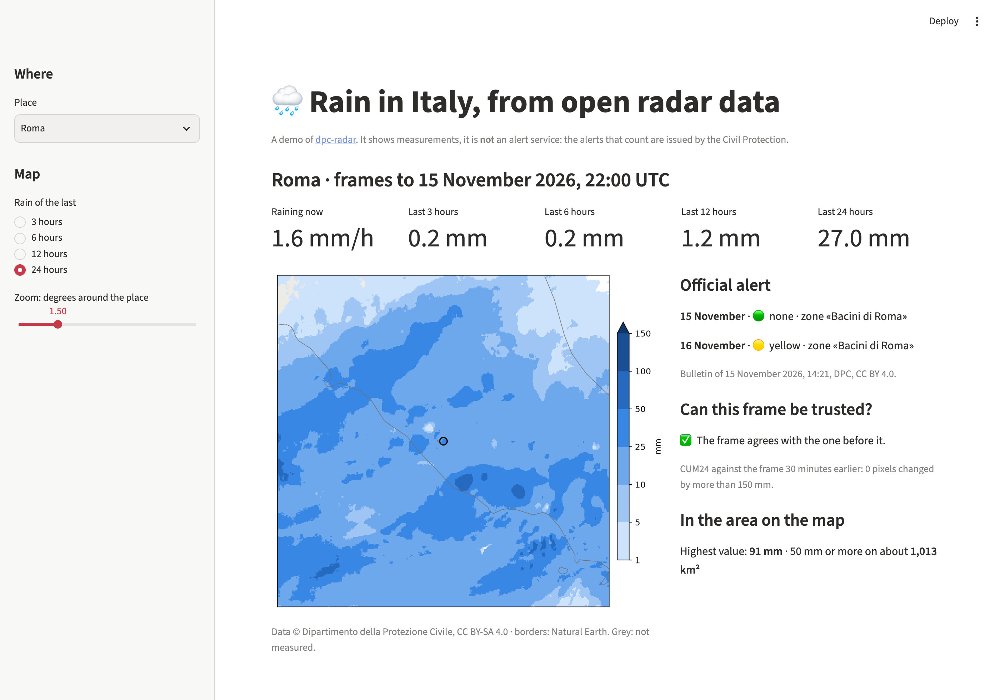

# Example apps

Four small programs, each one file, each one a starting point to copy.

```bash
git clone https://github.com/agent-engineering-studio/dpc-radar
cd dpc-radar
uv sync --group examples
```

| Program | What it does | Shows how to |
|---|---|---|
| [`rain_at.py`](rain_at.py) | the rain at a place: now, last 3–24 hours, and the official alert | read several products at once; `sample`; `zone_at` |
| [`storm_watch.py`](storm_watch.py) | watches an area and prints a line when a violent shower enters it | poll with `cached=`; `peak` over a box |
| [`nightly_archive.py`](nightly_archive.py) | keeps a local archive of the «Merging» up to date | `archive`, its report, a `limit` on requests |
| [`app.py`](app.py) | a rain dashboard for any town, in the browser | put it all together with Streamlit; `check` before showing |

## Rain at a place

```bash
uv run python examples/rain_at.py 12.50 41.90 --name Roma
```

Longitude first, then latitude. A place the radar does not cover prints
«not measured», never zero.

## Storm watch

```bash
uv run python examples/storm_watch.py --box 15.4 37.8 16.4 38.4 --rate 30
uv run python examples/storm_watch.py --once        # one look, then stop
```

`--box` is west south east north; `--rate` is the rain rate in mm/h that
counts as a violent shower; `--every` is how often to look, in seconds (a new
radar frame comes out every five minutes: looking more often is useless).

## Nightly archive

```bash
uv run python examples/nightly_archive.py ~/radar-archive --days 3
```

Run it again and it downloads only what is missing. In `cron`, once a night:

```cron
15 3 * * *  cd /path/to/dpc-radar && uv run python examples/nightly_archive.py /data/radar --days 3
```

Three days of Italy are about 100 frames and 100 MB.

## Dashboard

```bash
uv run --group examples streamlit run examples/app.py
```



## Fair use

The API is a public service with no stated limits. Be a good guest: ask for
a frame once (`cached=`), do not poll faster than the data changes, and keep
your own archive instead of downloading the same day twice.

None of these programs is an alert system. For official warnings, see the
DPC bulletin and your regional civil protection.
